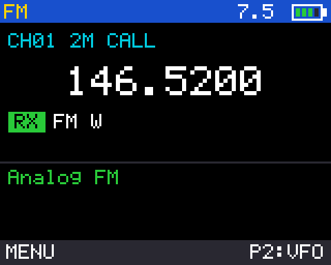

# D890UV custom firmware (cfw) — platform

A new firmware for the AnyTone D890UV (STM32U575). It is written from scratch, not lifted. It runs under the stock bootloader from `0x0800C000`, so the bootloader stays intact.

This folder holds the platform: build, drivers, HAL, modem interface and UI. Other sessions own `proto/` (protocol libraries) and `docs/` (feasibility).



## Build and run

```sh
cd D890UV_src/cfw
make                      # build/cfw.elf, build/cfw.bin (raw image for 0x0800C000), build/cfw.map
make LOOPBACK=1           # + loopback modem backend (proto TX symbols -> its own RX, no RF)
make KEEP_SWD=1           # don't use PA14 (SWCLK) as the PF2 key: keeps SWD usable on hardware
make DEBUG=1              # KEEP_SWD + SEGGER RTT log (hal/dbg.h) in build_dbg/; read: tools/hw/hw.py log; make DEBUG=1 gdb (docs/HARDWARE.md)
make EMU=1                # emulator test build in build_emu/: symbol-FIFO demod backend, decoders run on streams (never flash)
make HW=1                 # build meant for a real radio: settings are never written to flash (RAM only), TX at Low
make HW=1 HW_NOTX=1       # ... every TX refused ("TX inhibited"): first smoke test on a real radio (build_hw_notx/)
make HW=1 HW_SAVE=1       # ... codeplug loader: CPS link on PA9/PA10 + codeplug/settings flash writes (range-checked),
                          #     no PTT / no TX on the D890UV (PA10 = PTT). ONLY AFTER THE OWNER OKs FLASH WRITES.
make HW=1 HW_SAVE=1 HW_PASSWORD=1  # ... also enforces the codeplug power-on password (build_hw_save_pw/; needs HW_SAVE=1)
python3 tools/preflash_test.py --radio d890|d168   # emulator: pre-flash safety fixes F1-F9 (v0.6 below)
tools/make_streams.sh     # host: test symbol streams (*.sym) + 48 kHz discriminator samples (*.adc16/*.adc8)
make -C dsp test          # host: demodulator BER vs C/N + voice frames decoded, writes dsp/ber_table.md
SAMPLES=1 tools/emu_modes.sh   # emulator: every mode decoded by the MCU-DSP demod from discriminator samples
tools/emu_modes.sh        # emulator: play every stream on its built-in channel, montage per mode
tools/host_decode.sh p25 build_streams/p25_trunk.sym 1   # host: run one proto glue on a stream (fast check)
tools/efr_loop.sh         # host: NXDN96 EFR + NXDN48/96 encrypted voice through proto_nxdn TX->RX (bit exact)
make test-libs            # host: dmr_nxdn, p25, dstar_ysf, imbe tests + efr_loop + cfwcp / stockcp host tests (also in D168UV/cfw)
tools/stock_sections_test.py  # emulator: stock key tables (BP / ARC4 / AES / NX), Radio ID List, caller names, two radios
python3 tools/emutest.py NAME key:13 pf3 knob:2 shot …   # scripted emulator run + montage
make emu                  # build + 10 s in Renode
cd .. && python3 emu/run.py --elf cfw/build/cfw.elf --seconds 10     # screen -> emu/out/cfw/lcd.png
```

Toolchain: arm-none-eabi-gcc 14.2, newlib-nano (only `mem*`/`str*` are used). Image ≈ 72 KB with all six decoders, RAM ≈ 106 KB (two 40 KB framebuffers, decoder state, 8 KB codeplug index).

Drive it in the emulator like the stock firmware (see `emu/README.md`):
```sh
python3 emu/run.py --elf cfw/build/cfw.elf --seconds 3 --name t \
  --then "0|knob Turn 2" --then "0.5|shot" --then "0|lcd Press 13 100" --then "0.5|shot" \
  --then '0|board Set "A10" false' --then "0.5|shot"          # PTT
python3 emu/webui.py --launch cfw       # front panel (builds first); desktop app: d890uv-cfw on :8892
python3 emu/webui.py --launch cfw-emu   # same with the EMU=1 test build
```

Tested in Renode (2026-11-19):

| Test | Result |
|---|---|
| Boot | Boot screen, then the main screen. No fault. |
| Baseband init | Full SCT3288 init handshake (`baseband.log`) |
| NAND | ID `98ED`; data marker at `0x04EC0000` found |
| RF chips | Self-test passes on both |
| Battery | Reads 7.5 V |
| Knob | Changes channel |
| Up/Down keys | Change channel |
| P2 | Toggles VFO / memory |
| Menu → Info | Works |
| PTT | TX shown in red; returns to RX on release |
| Power off (`board PowerOff`) | Settings saved, latch dropped, reset. After `machine Reset` + `board PowerOn`, the saved channel comes back. |

Tested in Renode (2026-11-20, milestone 2):

| Test | Result |
|---|---|
| Mode switch, memory channel | PF3 cycles FM→DMR→P25→P25P2→DSTAR→NXDN→YSF→FM on codeplug channel 001; popup each time (`screens/mode_switch_pf3.png`) |
| Mode picker / settings | Menu > Mode lists every mode with its state; Menu > Channel settings edits CC / slot / TG etc. (`screens/menu_settings_picker.png`) |
| Codeplug | 1403 CPS channels read from NAND at boot (K6RRR codeplug: names, BCD freqs, shift, CTCSS, DMR CC / slot) |
| Edit persistence | DMR TG edited to 123 on the built-in DMR simplex channel (184 with `cfw_cps/examples/synth.d8cp`), Save now, power off / `machine Reset` / power on: channel and TG come back (`screens/settings_persist.png`) |
| Decoders (EMU=1 + `syms`) | DMR TG91<9990201; DMR Tier III TSCC→grant TG91 lpcn 5 (retunes 439.55); P25 TG100<1234567 NAC293; P25 trunk CC→site 3C1 1-2→grant TG100→460.55→back on CC; P25P2 TG4660<703710 S1 (172 voice frames); D-STAR N0CALL/D890>CQCQCQ + slow-data text; NXDN TG300<1001 RAN1; YSF XX0ABC>ALL DG-ID 20 with a DG-ID filter (`screens/decoders_all_modes.png`) |

Screens: `screens/`.

## Memory map / safety

| Range | Owner |
|---|---|
| `0x08000000–0x0800BFFF` | Stock bootloader. **Never written.** |
| `0x0800A000` (16 B) | Activation key. Not ours; the cfw doesn't check it. |
| `0x0800C000–0x0817FFFF` | cfw image. The vector table is at `0x0800C000`; the linker asserts it. |
| `0x08180000–0x081DFFFF` | cfw codeplug, 384 KB written by the CPS link (`app/cfwcp.c`, own address guard; `make HW=1` compiles the write out, `make HW=1 HW_SAVE=1` keeps it, only after the owner's OK). See "CPS link" below. |
| `0x081E0000–0x081E1FFF` | cfw settings page (`drivers/settings.c`). Besides the codeplug region below, this is the only flash the firmware ever erases or writes, and an address guard enforces that. `make HW=1` compiles the write out entirely (project notes: no flash writes on real hardware without the owner's OK). |
| `0x081E4000+` | Stock table cache. Not touched. |
| External NAND | Read only. There is no program or erase code in `drivers/nand.c`. Per-channel edits are therefore kept as overrides in the settings page, not written back into the CPS codeplug. |

Nothing has been flashed to real hardware. To put this on a radio, use `tools/hw/hw.py`, which is guarded and asks first, after `hw.py backup`.

## Layout

```
cfw/
  Makefile, ld/stm32u575_cfw.ld, startup/startup.c   build, memory map, vectors + reset + HardFault capture
  include/stm32u5.h        minimal register map (RM0456)
  hal/hal.h                driver API (everything above is hardware-independent)
  hal/board.h              pin map
  hal/modem.h              protocol plug-in interface (self-contained, host-buildable)
  hal/modem_core.h, modem.c  proto registry, mode switching, symbol plumbing, backends, vocoder dispatch
  hal/dsp_backend.c        MCU-DSP backend: ADC ring -> dsp/ -> modem_rx_push; TX modulator -> DAC ring; CPU load
  hal/voice.c              voice path: test tone / encode for TX, decode + g_emu_pcm ring + tone meter for RX
  drivers/                 clock time gpio lcd keys encoder power adc (48 kHz scan ring + battery) dac (TX baseband) nand rf baseband settings
  gfx/                     framebuffer (diffed flush), own 5x7 font, text
  app/                     main loop, channels (codeplug + built-ins), radio state, UI screens
  dsp/                     MCU-DSP demodulators + TX modulators (4FSK/C4FM/GMSK/H-DQPSK/CPM) + host tests
  voc/                     own TEST vocoder (voc_sine, 49/88-bit payloads, not interoperable) + tone meter
  app/protos/              platform glue for the proto libraries: DMR (+Tier III), NXDN, P25 P1 (+trunking),
                           P25 P2, D-STAR, YSF — registered with CFW_PROTO_REGISTER, built by default
  tools/                   gen_streams.c + make_streams.sh (test streams), host_decode (host glue check),
                           efr_loop (NXDN96 EFR glue loopback),
                           emutest.py / emu_modes.sh (scripted emulator runs)
  emu_test/                old emulator-only DMR glue (no longer built; app/protos/proto_dmr.c replaced it)
  screens/                 emulator screenshots
  proto/ docs/             other sessions
```

## Drivers and the stock code they mirror

| Driver | What | Stock reference (V1.05) |
|---|---|---|
| `clock.c` | HSE 12 MHz → PLL1 (M1 N20 R2) → 120 MHz, VOS range 1 + boost, 3 WS | `FUN_08062654`, SystemCoreClock `0x20000ff4` |
| `time.c` | SysTick = HCLK/8, 5 ms tick. `delay_us` busy-waits on SysTick VAL. | Stock OS tick. Delays: `FUN_0811ece0` (µs), `FUN_0811ec64` (ms). |
| `lcd.c` | 8080 bus: PE7–14 data (one BSRR write per byte), WR PD15, CS PD14, D/C PD12, RST PD13. Init, MADCTL 0x88, RGB565. | Init `FUN_0805d830`, cmd `FUN_080909a0`, data `FUN_08090944`, bus `FUN_0806e4c0`, window `FUN_0808aba0`. In the window, 0x2A = panel Y and 0x2B = panel X. |
| `keys.c` | 8×3 matrix: row PE7–14 low, columns PC4/PB1/PB2 active low; same key codes as stock. Side keys PTT PA10, PF3 PA8, PF1 PE2, PF2 PA14. Debounce, long press (1 s), event queue. | Matrix `FUN_08101260`; side keys `FUN_0811d9cc`. Matrix scan only runs while the LCD bus is idle (stock: `FUN_080cb08c`). |
| `encoder.c` | PC8/PC9 on EXTI8/9 (IRQ 19/20), both edges. A Gray-code table posts `0x11`/`0x12` once per detent. | `IRQ19_Handler 0x08030a4c`, `IRQ20_Handler 0x08030b54`, `FUN_080c85cc` |
| `power.c` | PC3 latch held. PA0 high ~100 ms after the first release → save hook, then LCD off, PC3 low, AIRCR reset. If PA0 is still high 3 s after reset (knob in the off position) → off again, as stock does. | `FUN_080d6954`, `FUN_08057db0`, `FUN_0813b98c` |
| `adc.c` | ADC1 (12-bit, HSE clock) scans ch1 (FM discriminator), ch2 (battery), ch3, ch12, ch19 (temperature), one scan per TIM15 TRGO at 48 kHz (EXTSEL 14), GPDMA1 ch0 linked-list circular into a 3840-scan (80 ms) ring; the write position is read from C0BR1.BNDT. Battery/temperature from frame 0. V×100 = (raw·0x528>>12) + cal − 100. | `FUN_0805c4ac`, `FUN_08039024`. Calibration is fixed at 100 until its NAND location is known. |
| `dac.c` | TX audio = TIM4_CH4 PWM on PB9 (AF2) at 48 kHz (ARR 2499), CCR4 reloaded by GPDMA1 ch1 (request 71 tim4_upd, self-linked ring of 3840 = 80 ms; read position C1BR1.BNDT); PB9 analog when idle. APC = DAC1 ch1 PA4 + TX enables PE1/PA15; UHF RX tune = DAC1 ch2 PA5, VHF tune = RF reg 0x5C; tables from the NAND RF calibration block 0x04F00000/0x04F40000 (level `CFW_APC_LEVEL`, default 0 = low). | PWM `FUN_08062f04`, `FUN_08114e84`, `FUN_08125854`, pin `FUN_0811a730`/`FUN_0811a6d4`; APC `IRQ17_Handler`, `FUN_0811a75c`, `FUN_0801694c`; tune `FUN_0811c8f0`, `FUN_0811cadc`, `FUN_08049fc4`, `FUN_0804a0a0`; cal `FUN_080e0440`. `docs/AUDIO_PATHS.md`. |
| `nand.c` | Bit-banged SPI-NAND, read only: ID `0x9F`, `0x13` page→cache, poll `0x0F C0`, `0x03` x1 read. CPS address = NAND address. | `FUN_08037db8` / `FUN_080377a4` / `FUN_080379b4`. Stock uses the x2 read `0x3B`. |
| `rf.c` | 3-wire bus (SCK PB3, SDA PB4, CS PB5/PD3): `(reg<<1)\|R` + 16 bits. Self-test 0x57 = 0xA888. Full power-up register list. Frequency = regs 0x69:0x68 in Hz. RX set-up (two filter sets). TX set-up (chip 0). CTCSS reg 0x31. | Write `FUN_080e2f64`; read `FUN_080e2cac` / `FUN_080e2da4`; init `FUN_0805ffe8` (+ `FUN_081155ac`, `FUN_0802520c`, `FUN_080e2edc`, `FUN_08116480`); freq `FUN_08116674`; RX/TX `FUN_0810ea14`, `FUN_080c3d18`, `FUN_080c39e4`; RX mode reg 0x30 `FUN_080e4154`; CTCSS `FUN_080e3c20`. See `docs/rf_chip.md`. |
| `baseband.c` | SPI2 (PB13–15 AF5, CS PB12; ready lines PD11/PD7; reset PD9). Frames `84 A9 61 LenH LenL B0 ID data [pad]`; a read is a dummy write of the last TX byte. Non-blocking init: 0x17=0x0E → raw `74 A9 01 00 01 00` → 0x17=00 → cmd 0x2D → cmd 0x33 (B0 0x23, version) → 0x10=00 → ready. After that, frames go to a listener. | Parser `FUN_0813af78`, write `FUN_0810a674`, read `FUN_0810a6dc`, init `FUN_080fa16c` / `FUN_080e70ec` / `FUN_080e6c64`, `FUN_0810061c`, `FUN_08100664`, `FUN_081005cc`, `FUN_080f30c4` |
| `settings.c` | Append-only records (CRC32) in the 8 KB page `0x081E0000`; quad-word programming; page erase only when the page is full. | — |

### Emulator hooks

The cfw carries two symbol aliases on purpose. `emu/run.py` looks these names up in any ELF; no emulator change was needed.

| Alias | Real function | Why |
|---|---|---|
| `FUN_0811ece0` | `delay_us` | The emulator skips the wait instead of letting the CPU poll SysTick. |
| `FUN_080e2da4` | `rf_shift_in16` | The emulator returns the RF model's register value. Renode cannot pass SDA back on GPIOB. |

Both must stay real functions that are not inlined. The Makefile fails the build if either symbol is missing.

Emulator additions (2026-11-20, emulation session; details in `emu/README.md` "Custom firmware"):

| What | Where | Notes |
|---|---|---|
| RX signal status | `drivers/rf.c` `rf_rssi()` (reg 0x02 [9:0]), `rf_carrier()` (reg 0x0E bit 14), `rf_rssi_dbm()` | Same registers the stock squelch `FUN_080d22f0` reads. The dBm scale (0.5 dB/step from −160) is an assumption shared with the emulator model. `radio_tick` reads them every 100 ms in RX; the main screen shows `-NNdBm` and a green RX badge with carrier (grey without). |
| Symbol FIFO backend | `hal/emu_syms.c` (`g_backend_emusyms`, `make EMU=1` only) | Reads the emulator-only FIFO at `0x5FFF0500` (`syms Load @file 4800`) at the symbol rate and pushes into `modem_rx_push`. Stand-in for the MCU-DSP demodulator. Not built in the normal image (that address is not a peripheral on the chip). |
| DMR receive test glue | `emu_test/dmr_emu.c` | Superseded 2026-11-20 by `app/protos/proto_dmr.c` (built in every build); no longer compiled. |

Verified in Renode: `rf0 Signal 146520000 -80` → `-80dBm`, green RX (`screens/emu_rf_signal.png`: −80, −100 dBm at
+5 kHz, off). The EMU=1 build decodes `emu/streams/dmr_call.dibits` (generated with the proto library's TX side):
call TG 91 from 9990201 on TS1, all 90 voice frames, terminator seen (`screens/emu_dmr_rx.png`).

## Simplex / repeater / talkaround (2026-11-21)

Every channel is either **simplex** (TX = RX frequency) or **repeater** (TX offset). A repeater channel can be used
simplex with **talkaround** (TX on the RX frequency): `#` held on the main screen, or Channel settings > Talkaround.
The main screen shows `SIMPLEX`, `Shift ±x.xxx` or `TALKAROUND`; TX goes out on the effective frequency
(`radio_tx_hz()`), and the protos get `cfw_chan_cfg_t.direct` (simplex or talkaround) to pick the framing:

| Mode | Simplex / talkaround (direct) | Via repeater |
|---|---|---|
| FM | TX on RX frequency, CTCSS as set | TX offset |
| DMR | ETSI direct mode: MS-sourced voice/data syncs, one burst per 60 ms, the other 30 ms unmodulated, no CACH (`dmr_call_tx`, `DMR_LINK_DIRECT`). Option **TDMA direct** (Channel settings, CPS CHEXT flags b2): dual-capacity direct with TS1/TS2 direct syncs. RX hears BS, MS and direct bursts | MS-sourced bursts (`DMR_LINK_REPEATER`, not yet aligned to the repeater's CACH slot timing); RX expects the repeater output (CACH) |
| P25 Ph1 | conventional, channel NAC (default 293; F7E = accept any on RX) | same, TX offset |
| P25 Ph2 | test link only (outbound slot format) | — |
| NXDN | LICH RF channel type RDCH (direct) | RTCH (inbound to a repeater) |
| D-STAR | header RPT1 = RPT2 = `DIRECT`, flag1 0 (`dstar_header_simplex`) | RPT1 = channel RPT1 (repeater + module), RPT2 = gateway if it ends in G, flag1 0x40 (`dstar_header_repeater`) |
| YSF | MR = direct (a repeater rewrites MR on its downlink) | same |

The demodulator knows all eight DMR sync words (BS, MS, direct TS1/TS2 voice/data) and freezes its level/DC
tracking during unmodulated TDMA gaps; without that, DMR direct mode lost ~40 % of the voice frames. Two more fixes
for direct mode (2026-11-21): the symbol-clock integrator is clamped to ±1000 ppm (was ±1 %: a pre-sync transient
drove it to the clamp, and over each 144-symbol gap the free-running clock slipped more than a symbol, so decoding
depended on where the receiver happened to start — 54..162 of 162 frames on the host, ~half in the emulator), and the
timing detector skips the first strobes after a gap (the 0 → symbol edge is not a symbol transition). Host check:
`PAD=n DIRECT=1 build_streams/capdecode dmr capture.adc16` now gives 162/162 frames for every start offset tried.

**FM test path:** with Menu > Test tone on, FM TX also puts the tone (2.5 kHz deviation, plus the channel's CTCSS at
500 Hz) on the MCU TX audio output (TIM4_CH4 PWM on PB9, `dspb_fm_tx`), and the FM receiver feeds ADC1 ch1 audio (8 kHz, DC removed) to the tone
meter and `g_emu_pcm` (`dspb_fm_rx`). On a real radio FM audio goes mic → RF chip; the PB9 path (the pin stock uses for MDC/APRS AFSK) is for the
tone test (`CFW_MCU_FM_TX`, every build; dummy load). Verified: radio A 2M CALL 146.520 TX capture 440.0 Hz; radio B `AF 439.9Hz 55dB SINAD`.

**Test hooks for two radios:** `g_dbg_my_id` (uint32) and `g_dbg_my_call` (char[9]) — a script writes them before PTT
to give each emulated radio its own ID / callsign; `s_tone_hz` = the test tone; `g_emu_pcm` / `g_emu_pcm_wr` = decoded
audio. Built-in channels 14 `P25P2 SMPLX` 445.500 and 15 `NXDN96 SMP` 441.375 (offset 14, `--mode nxdn96`) were appended for the simplex test. Per-channel overrides (uint16,
script writes value + 1, 0 = untouched, applied to the current channel, not saved): `g_dbg_talkaround` (1 on, 2 off),
`g_dbg_cc`, `g_dbg_nac`, `g_dbg_ran`, `g_dbg_dgid` — used by `emu/txrx_loop.py --filters`.

**Simplex matrix** (2026-11-21, emulator, two cfw radios, `emu/txrx_loop.py --simplex --filters`, 440 Hz test tone,
A = 9990201 / XX0AAA, B = 9990202 / XX0BBB; reports `emu/out/txrx_loop_mx.md`, `_cc`, `_imbe`, `_sct2`, `_sct3`):

| Mode | A → B | B → A | sine backend tone / SNR | SCT3288 path (`--voc 3`, emulator stand-in) | IMBE (`--voc 2`) |
|---|---|---|---|---|---|
| FM | PASS | PASS | 440.0 Hz / 71.6 dB | — | — |
| DMR direct | PASS, TG99 < 9990201 TS1 | PASS, < 9990202 | 439.9 Hz / 88.5 dB | PASS 440.0 Hz / 67 dB | — |
| P25 Ph1 | PASS, TG1 < 9990201 | PASS | 439.9 Hz / 79.2 dB | (IMBE) | PASS 441.4 Hz / 27 dB |
| P25 Ph2 | PASS, TG1 < 9990201 S1 | PASS | 439.9 Hz / 53.7 dB | PASS 440.0 Hz / 55 dB | — |
| D-STAR DIRECT | PASS, XX0AAA/CFW > CQCQCQ | PASS, XX0BBB | 439.9 Hz / 77.4 dB | PASS 440.0 Hz / 70 dB | — |
| NXDN48 RDCH | PASS, TG1 < 28729 RAN1 | PASS, < 28730 | 439.9 Hz / 78.0 dB | PASS 440.0 Hz / 68 dB | — |
| YSF direct | PASS, XX0AAA > ALL | PASS, XX0BBB | 439.9 Hz / 77.4 dB | PASS 440.0 Hz / 62 dB | — |

Filters (simplex channels, set with the `g_dbg_*` hooks): DMR CC 1→2 no decode / 1→1 decode; P25 NAC 293→123 no decode /
293→F7E decode; NXDN RAN 1→2 voice muted (IDs shown) / 1→0 decode; YSF DG-ID 20→10 no decode / 20→0 decode: all PASS.
Bugs this matrix found and fixed: DMR direct timing (above); the DMR library handed out voice bursts before their EMB
colour code was checked (now fixed in proto/dmr_nxdn: voice only after the call's CC is known good); the
SCT3288 encode-ahead queue was 6 frames, too short for P25 Ph2 (a 4V/2V burst set pulls many frames at once) → 24.
The "repeater channel TX → simplex RX" negative case now decodes by design (the RX accepts BS, MS and direct bursts);
frequency separates them — cfw-emu's `--rf-gate` / `--talkaround` cases test that.
Full matrix re-run by cfw-emu with `--rf-gate` (5 Hz tone tolerance): 39/39 PASS — all 7 modes both directions (sine),
filters, talkaround (both talkaround → decode, TX-only → decode, RX-only → no decode), IMBE P25 441.4 Hz / IMBE YSF
439.9 Hz, SCT3288 incl. P25P2 440.0 Hz / 54.9 dB. Tables: emu/README.md "Simplex matrix".

## Digital transmit (2026-11-21) — TEST ONLY, DUMMY LOAD ONLY

PTT in a digital mode now transmits: audio (Menu > Test tone 440 Hz, else the microphone through the SCT3288;
silence when the chip does not answer) → vocoder → proto TX framing (`app/protos/*`: `tx_start` / `tx_symbols` / `tx_stop`, voice frames pulled with
`pf->voice_tx`, modem API v3) → `dsp/dsp_mod.c` modulator → TIM4_CH4 PWM on PB9 at 48 kHz, CCR4 from a GPDMA ring on the TIM4 update request
(`drivers/dac.c`; PB9 = the stock MCU TX audio pin, `docs/AUDIO_PATHS.md`) → RF chip keyed like stock (reg 0x56 = 2, reg 0x52 = 0x3041; release 0x0041 → 0x4041, traced by the
cfw-emu session; stock never keys with reg 0x30) with the stock APC level on DAC1 ch1 (PA4, stock `FUN_0811a75c` value from the NAND RF calibration block;
0x0FF0 when the block is erased, as in the emulator) and the TX enables PE1 / PA15.
FM TX now keys the same way. The screen shows `TX TEST: DUMMY LOAD ONLY`, the codec warning, the audio source and
whether the TX DMA is moving.

| Mode | TX framing | Modulator | Vocoder backend | Interoperable | Host 440 Hz test (20 dB hard) | Emulator two-radio | Hardware |
|---|---|---|---|---|---|---|---|
| DMR | BS-format voice superframes (CACH, LC/EMB, header ×2, terminator), TS1 | 4FSK RRC 0.2 | sine (TEST) | no (codec; BS burst format instead of MS direct mode) | 439.9 Hz, 60+ dB, 144/144 frames | TG91 < 9990201, 439.9 Hz, 79 dB | unverified |
| P25 Ph1 | HDU, LDU1/LDU2 (IMBE 88), TDU | C4FM RC × inv. sinc | sine (TEST, 88 bit) | no (codec) | 439.9 Hz, 60+ dB | TG1 < 9990201, 439.9 Hz, 86 dB | unverified |
| P25 Ph2 | outbound superframes: 4V/2V voice ch 0, MAC_PTT/END_PTT, scrambled | CPM h=1/4 1RC (not H-CPM) | sine (TEST) | no | 439.9 Hz, 60+ dB | TG1 < 9990201 S1, 439.9 Hz, 54 dB | unverified |
| NXDN48 | VCALL FACCH1, EHR voice frames + SACCH, TX_REL | 4FSK RRC 0.2, 2400 sym/s | sine (TEST) | no (codec) | 439.9 Hz, 60+ dB | TG1 < 28729, 439.9 Hz, 59 dB | unverified |
| D-STAR | header (MY/UR/RPT1/RPT2), voice + slow-data text, end | GMSK BT 0.5 | sine (TEST, 49 bits in the 72-bit slot) | no (codec) | 439.9 Hz, 60+ dB | N0CALL/CFW > CQCQCQ, 439.9 Hz, 77 dB | unverified |
| YSF | HC, V/D mode 2 (VD2), TC | C4FM | sine (TEST) | no (codec) | 439.9 Hz, 60+ dB | N0CALL > ALL, 439.9 Hz, 77 dB | unverified |

Full host tables (tone, SINAD, frame counts at 40/20/14/10 dB; modulator BER, peak deviation, 99 % bandwidth):
`dsp/README.md`. (The matrix above was taken with the `sine` backend.)

**Vocoder backends** (`hal/voice.c`, `g_voc_select`: 0 auto, 1 sine, 2 imbe, 3 SCT3288; the TX screen shows the codec):

| Backend | Codes | Source | Status |
|---|---|---|---|
| `imbe` | IMBE 7200x4400, 88-bit (P25 Ph1); auto/2/3 pick it for IMBE | `voc/imbe` (cfw-p25 session: mbelib-compatible dequantisation, own encoder + synthesis) | emulator P25 simplex A→B and B→A: 441.4 Hz, 27 dB SINAD, PASS; mbelib decodes its frames; not tried against a real P25 radio. M33 cost: enc ~269k / dec ~141k instructions per 20 ms frame |
| `SCT3288` | AMBE+2 49-bit (DMR, NXDN EHR, YSF DN, P25 Ph2) | the baseband chip (`hal/voc_sct.c`, `docs/SCT3288_VOCODER.md`). Mode A: mic → chip → channel frames on SPI2 and frames → chip → speaker, with the commands stock uses for voice record / play; mode B: PCM from the MCU (test tone); for the software IMBE coder the chip gives mic PCM and plays PCM. Mode C: external AMBE packets | auto picks it when the start-up probe is answered (screens: `BB voc A` …), otherwise `sine`. Every command passes the allow-list `hal/bb_allow.h`. Only the emulator stand-in answers today (framing and flow, not audio quality); nothing verified on hardware. No D-STAR (3600x2400) and no full rate in the chip |
| `sine` | 49-bit / 88-bit payloads | `voc/voc_sine.c` | TEST ONLY - NOT INTEROPERABLE; fallback when neither of the above is there |

No legal open AMBE+2 software encoder exists, so AMBE modes are interoperable only through the SCT3288.
`make DEBUG=1`: bench check of the chip (RTT key `b` or `g_sct_bench = 1`, receive side only, `docs/SCT3288_VOCODER.md` section 6).

**Safety:** `make HW=1` compiles digital TX out (PTT says `DIGITAL TX OFF`); only `make HW=1 HW_DTX=1` enables it,
and then only into a dummy load. TX audio leaves on PB9 = TIM4_CH4, the pin the stock firmware plays MDC-style data and
APRS AFSK through (`docs/AUDIO_PATHS.md`), so it does reach the modulator, but its filter / coupling / pre-emphasis is
unknown: 4FSK/C4FM/GMSK through it must be checked on a service monitor first. PA4 = APC, PA5 = UHF RX tune (both
as stock, from the NAND calibration block; VHF tune = RF reg 0x5C).

**Emulator:** `models/Pwm.cs` (replaces timer4) captures the PB9 PWM duty (CCR4 / period, 12 bit) while the RF model
is keyed; `emu/txrx_loop.py --mode all`
keys radio A with the 440 Hz test tone, feeds the capture into radio B with `analog Stream`, and measures the PCM radio B
decodes (`g_emu_pcm`, 8 kHz ring) plus the firmware's own meter (`AF 439.9Hz xxdB SINAD` on the main screen).
Result (2026-11-21, `emu/txrx_loop.py --mode all`, clean channel; `emu/out/txrx_loop.md`,
`screens/tx_two_radio_all_modes.png` is from the 2026-11-23 rerun below: radio A transmitting, radio B mid-call and at
the end):

| Mode | Radio B decoded | Tone (B's PCM) | SNR | B's own meter |
|---|---|---|---|---|
| DMR | TG91 < 9990201 TS1 | 439.9 Hz | 79.0 dB | AF 439.8 Hz |
| P25 Ph1 | TG1 < 9990201 | 439.9 Hz | 86.3 dB | AF 439.8 Hz |
| P25 Ph2 | TG1 < 9990201 S1 | 439.9 Hz | 53.7 dB | AF 439.8 Hz |
| D-STAR | N0CALL/CFW > CQCQCQ | 439.9 Hz | 77.4 dB | AF 439.8 Hz |
| NXDN48 | TG1 < 28729 RAN1 (16-bit unit id) | 439.9 Hz | 58.9 dB | AF 439.8 Hz |
| YSF | N0CALL > ALL | 439.9 Hz | 77.4 dB | AF 439.8 Hz |

Two bugs this test found and fixed: the 20 ms DAC/ADC rings underran during UI redraws and vocoder bursts (stale
20 ms in the TX capture, lost NXDN VCALL, garbled NXDN/YSF frames) — both rings are now 80 ms and the main loop services
the modem between tasks; and after a late entry the NXDN library parses the VCALL from SACCH without an event, so the
glue now takes the IDs from the SACCH message. The cfw-emu session's run with 20 dB AWGN in the discriminator domain
and 300 Hz offset gave DMR 84 / P25 80 / P25P2 83 / D-STAR 77 dB (old rings) and, after the fixes, NXDN 78.0 dB
(TG1 < 28729) / YSF 83.9 dB. Host check of any capture:
`build_streams/capdecode MODE file.adc16` (call IDs, per-frame vocoder bits, tone per 0.25 s).

Rerun 2026-11-23 on made-up data only (`EMU_NO_ANYTONE=1`: emu synth.pages, built-ins from channel 9):
`txrx_loop.py --simplex --mode all --filters --rf-gate --voc 1` — D890UV 24/24 PASS (FM, DMR, P25, P25P2, D-STAR,
NXDN48, NXDN96, YSF both directions + 8 filter cases), D168UV 22/22 PASS (no NXDN96). NXDN unit IDs 28729 / 28730
(= 9990201 / 9990202 & 0xFFFF).

## Demodulation (MCU-DSP, 2026-11-20)

All digital modes now have a demodulator on the MCU: `hal/dsp_backend.c` (backend `MCU-DSP`) reads ADC1 ch1 —
the RF chip's FM discriminator output — from the 48 kHz ADC ring, runs the `dsp/` demodulator for the current mode
from the main loop (`modem_poll`, every pass; the ring holds 20 ms) and pushes symbols + confidence into
`modem_rx_push`. Details, chain and BER tables: `dsp/README.md`.

| Mode | Demodulator | BER @ 14 dB / 20 dB, hard channel¹ | Voice frames @ 10 dB | Emulator from samples | Hardware |
|---|---|---|---|---|---|
| DMR (4FSK 4800, RRC) | RRC MF + Gardner + sync LS | 6.9e-5 / 0 | 100 % | TG91 < 9990201 ✓ (Tier III grant ✓) | unverified |
| P25 Ph1 (C4FM 4800) | I&D MF | 5.9e-3 / 1.4e-4 | 100 % | TG100 < 1234567 ✓ (trunk ✓) | unverified |
| YSF (C4FM 4800) | I&D MF | 6.0e-5 / 0 | 100 % | XX0ABC > ALL DG-ID 20 ✓ | unverified |
| NXDN 4800 (4FSK 2400) | RRC MF | 9.5e-4 / 8.4e-4² | 100 % | TG300 < 1001 RAN1 ✓ | unverified |
| NXDN 9600 (4FSK 4800) | RRC MF | 9.0e-4 / 8.4e-4² | EFR = IMBE_88 (voc/imbe), glue in proto_nxdn | — | host loopback 198/198 bit-exact (`tools/efr_loop.sh`); emulator simplex A↔B PASS 441.4 Hz / 28.7 dB (`--mode nxdn96`) |
| D-STAR (GMSK 4800) | Gaussian MF, 2-level | 0 / 0 | 100 % | N0CALL/D890 > CQCQCQ + text ✓ | unverified |
| P25 Ph2 (H-DQPSK 6000) | discriminator I&D | 1.7e-2 / 1.0e-2 | 97 % | TG4660 < 703710 ✓ | unverified |

¹ +1 kHz offset, +100 ppm clock, −10 % deviation, C/N in 12.5 kHz. ² start-up, not steady state (dsp/README.md).
P25 Phase 2 through a discriminator costs ~13 dB against a coherent receiver at BER 1e-2 and floors near 6e-3; FEC
still recovers the voice frames above ~10 dB in the test.

**Coping with an unknown audio path** (ch1 flatness / coupling is not known until measured on a radio):
DC / frequency-offset tracking, AGC on the deviation (coarse until the first sync, then least-squares from the sync
word and LMS tracking), polarity from the sync word (DMR: Menu > RX polarity), Menu > De-emphasis comp
(off / 750 µs inverse filter; tested: BER 0.38 → 0 on a de-emphasised DMR signal).

**UI:** with the MCU-DSP backend every digital mode is green; the popup and picker say `demod: unverified on HW` /
`demod*`. The mode area's bottom line shows `MCU-DSP LOCK q95 10.5%` (sync lock, quality 0..100 from the EVM, CPU
load of the receive path); Menu > Info shows `Demod MCU-DSP CPU x.x%`.

**CPU load** (whole receive path: demod + proto decoder, measured with the SysTick µs clock in the emulator =
instruction count at Renode's 100 MIPS; not measured on the radio, where the M33 at 120 MHz should be similar):

| Mode | Load |
|---|---|
| DMR | 21 % (Tier III TSCC + traffic: 35 %) |
| P25 Ph1 | 6 % (trunking 11 %) |
| P25 Ph2 | 10 % |
| D-STAR | 14 % |
| NXDN48 | 20 % |
| YSF | 12 % |

Where the time goes: RRC matched filter (DMR 41 taps, NXDN48 81 taps at 24 kHz) and the sync correlator (DMR checks
4 × 24 symbols every symbol). Both can be cut (polyphase / fixed-point MAC, incremental correlation) if needed.

**Emulator, end to end from samples:** `tools/make_streams.sh` also writes `build_streams/<call>.adc16` (uint16 LE,
12-bit ADC counts, 2048 + 0.25 count/Hz, 48 kHz) and `.adc8` (counts >> 4). Each is a proto test call through the
channel simulator at 25 dB C/N, +500 Hz offset, +50 ppm.

Normal build, real ADC path (since 2026-11-20 the emulator's `analog Stream` drives TIM15 → ADC1 scan → GPDMA ring
exactly as `drivers/adc.c` sets them up):
```sh
make && python3 emu/webui.py --launch cfw
# select channel 1411 (type 1411#), then in the monitor box:
analog Stream @cfw/build_streams/p25_call.adc16 48000
```
→ `TG100 < 1234567`, `MCU-DSP LOCK q99` (`screens/demod_adc_injector_p25.png`). The cfw-emu session's
`emu/streams/test_cfw_adc.sh` runs all eight this way; all decode (`screens/demod_adc_injector_all_modes.png`). With no stream
playing the emulator keeps the ADC running with ch1 at mid-scale (like a real ADC), so BNDT always moves.

Fallback (EMU build, no injector needed): a file loaded into the symbol FIFO at ≥ 20000/s is treated as 8-bit samples
and goes through the same demodulator (`hal/emu_syms.c`): `syms Load @…/p25_call.adc8 48000`.
`SAMPLES=1 tools/emu_modes.sh` runs all eight that way (`screens/demod_from_samples_all_modes.png`). This 8-bit path is marginal (lock quality q1-q90 vs q95-q100 on the ADC path) and timing-sensitive: in the 2026-11-23 build the DMR call header and the YSF callsign are missed (voice frames decode), while the host decoder (`dsp/test/capdecode`) decodes the same files fully and the ADC injector path decodes all eight.

## Main loop

The scheduler is cooperative and runs everything in thread mode (`app/main.c`). Interrupts (SysTick, encoder) only count ticks or post key events.

| How often | What runs |
|---|---|
| Every pass | `bb_poll`, `modem_poll` |
| 10 ms | modem / proto tick, radio tick |
| 20 ms | keys, power key |
| 100 ms | UI redraw |

Between passes the loop sleeps in WFI. The UI redraws the whole screen into a back buffer each time. `gfx_flush()` diffs it against the front buffer and sends only the bounding box of changed pixels, so an idle screen costs no bus traffic.

There is no RTOS. FreeRTOS can be added later if a proto needs blocking threads. The modem interface is callback-based and works either way.

## UI v0.3: menu tree toward the stock feature set (2026-11-22)

Shared by both radios (`app/ui.c` main / mode / channel settings / info, `app/ui_menu.c` menu tree, `app/rset.c`
settings, `app/scan.c`, `app/calllog.c` call log + SMS boxes, `app/gps.c` + `app/aprs.c`). Lists scroll (D890UV
160x128: 8 rows, D168UV 128x160: 11 rows); Up/Down/knob move, Menu selects, Exit back, digit 1-9 = row 1-9.
A grey help line above the soft keys says what the selected item does on this firmware.

| Menu item | What it does | Codeplug source |
|---|---|---|
| Zone | zone list (+ "All channels"); selecting one restricts knob / Up / Down / channel list / zone scan to it | section 3 zones |
| Channels | channels of the current zone (number, name, mode; help line = frequency) | sections 2 / 3 |
| Contacts | talk groups / private contacts; Menu = TX target of the current channel (group / private / all call) | section 5 |
| Manual dial | DMR ID/TG (`#` = group / private), P25 TGID, NXDN group, YSF DG-ID | - |
| Call log | last 16 digital calls heard / made (time, ID or callsign / talker alias, TG); Menu = call back, last row = clear | RAM + settings blob |
| SMS | DMR only: New message (target, multi-tap text, `#` case, `*` delete, Menu send), Inbox, Outbox, Quick texts (stock PrefabricatedSMS) | section 10 table 6 |
| Scan | start / stop, scan list (codeplug lists or the zone), nuisance delete count | section 4 (members, priority 1, dwell), channel scan list / scan skip |
| Monitor | squelch held open (`MON` in the status bar) | - |
| Settings | squelch, TX timeout, VOX, key beep, volume limit, backlight, light time, power save, auto power off, key lock (manual/auto), clock, TX power (channel), key functions, date, time | section 10 OptionalSetting + journal |
| Mode, Channel settings, Step, RX polarity, De-emphasis comp, Test tone | unchanged mode-specific tools | |
| GPS / APRS | NMEA fix (lat/lon/alt/locator/UTC/sats); Menu = APRS position beacon | - |
| Info, Save now | as before | |

**Main screen additions:** status bar `SCAN`/`SCN` (scanning / stopped on a busy channel), `MON`, envelope = unread SMS,
`HH:MM` (Settings > Clock, D890UV only: no room on the 128 px panel). DMR calls show `PRV` for private calls and
`TA <alias>` once the talker alias arrives. While scanning: Exit stops, `*` deletes the channel from this scan,
Menu opens the scan menu, PTT stops and transmits on the channel scanning stopped on.

**Key functions** (Settings > Key P1/P2/PF1/PF2/PF3/PF3 long; D168UV: PF1/PF2): None, Next mode, Mode list, VFO/MEM,
Key lock, Monitor, Scan, Test tone, Next zone, Talkaround, TX power, Call log, GPS info (CPS `KEY_FUNCS`, new ones:
talkaround, tx_power, call_log, gps_info). Defaults as before (P1 / PF3 next mode, P2 VFO/MEM, PF3 long mode list).

**Settings** (value = stock CSV value = index in the stock radio's option list, `D168UV/emu/MENUS.md`):

| Setting | Stock column | cfw effect |
|---|---|---|
| Squelch Off/1-5 | `SQL1` | stock calibrated squelch (`docs/CALIBRATION.md`): reg 0x49 = threshold from the RF calibration block for the frequency and level; FM audio muted unless carrier and RSSI >= threshold, closes 12 below (stock 3-poll debounce); scan stop threshold. `tools/sql_test.py` |
| TX timeout Off/30-240 s | `TOT` | PTT dropped after the time, "TX TIMEOUT" until PTT is released |
| VOX Off/1-3 | `VOX` | stored only (no microphone path yet) |
| Key beep | `Beep` | stored only (no speaker path yet) |
| Volume limit Indoor/1-8 | `MaxVol` | stored only (no speaker path yet) |
| Backlight 1-5 | `Lightness` | D890UV: PB0 TIM3_CH3 PWM, stock levels 2550/2750/2850/2950/4095; D168UV: stored (pin not mapped) |
| Light time Always/5 s-1 h | `AutoBKLightTime` | backlight off after no key; first key only wakes |
| Power save Off/1:1/2:1 | `PowerSave` | stored only |
| Auto power off Off/10-120 min | `AutoPowerOff` | power off (save + latch) after no key / PTT / received call |
| Key lock Manual/Auto | `KeyLock` | Auto: locks 10 s after the last key on the main screen (long `*` unlocks) |
| Clock Off/On | `DateDisKind` | time in the status bar |
| TX power Low/Mid/High/Turbo | channel `power` (journal table 0xE2) | D890UV: stock APC calibration table of that level (was always Low); D168UV: stored, APC fixed |
| Key ... | settings record `keys[]` (journal 0xE0) | key remapping above |
| Date / Time | RTC | D890UV STM32U5 RTC (TR/DR, INIT mode), D168UV counter (CNT); not verified on hardware |

**Saving / CPS read-back:** leaving Settings (and Save now / power off) writes the edits into the codeplug's *radio
edits journal* (`cfwcp_journal_write`): the CPS (`cps/stock.py STOCK_SPARE`) leaves 1 KB of zeros at the end of section
10 when it writes a radio; the firmware puts a marker entry (0xEE), the edits (stock entry format) and a 4-byte CRC
fix entry (0xEF) there, chosen so the CRC in the header stays valid, and rewrites only that flash page (8 KB). The CPS
decodes the journal into its model (OptionalSetting values, `settings.keys`, channel power), so a read shows the radio's
changes and the next write folds them into the normal entries. A codeplug written by an older CPS (no spare) or no cfw
codeplug at all: the edits go into the radio's settings blob instead. `HW=1`: neither is written (RAM only).
Format: `cfw_cps/docs/CODEPLUG.md` "Radio edits journal". Power loss during the page rewrite leaves the codeplug
invalid (CRC) - the radio then falls back to its NAND/built-in channels until the CPS writes it again.

**SMS / talker alias (DMR):** SMS = unconfirmed rate-1/2 data, SAP 9, payload `CFS\x01` + length + text (64 chars),
after 3 idle bursts for receiver sync; the cfw's own format, not the AnyTone / Motorola / Hytera SMS formats.
Talker alias TX: codeplug radio name, else the callsign, in the embedded LC of odd superframes (FLCO 4..7), the voice LC
in even ones; form = stock alias format (ISO 8 bit max 27 chars, ISO 7 bit 31, Unicode = UTF-16BE 13). RX decodes 7-bit /
ISO 8-bit / UTF-8 / UTF-16. In the 8/16-bit forms the first of the 49 header bits is reserved (from memory of
TS 102 361-2 7.2.18, no real capture checked); `tools/ta_host_test.py` (in `test-libs`).

**GPS / APRS:** USART2 9600 NMEA ($xxRMC, $xxGGA) by interrupt on both radios (GPS UART pins / power switch not mapped
for hardware). APRS beacon: AX.25 UI frame `<call>>APZCFW,WIDE1-1:!DDMM.mmN/DDDMM.mmW>cfw <call>`, Bell 202 AFSK
1200 Bd (NRZI, bit stuffing, FCS), ~270 ms of flags first, on an analog FM channel's TX frequency through the FM TX
audio path (D890UV TIM4_CH4 PWM, D168UV TMR4_CH4 PWM). Analog / digital APRS receive is not implemented.

**Tests (emulator, both radios):**

| Test | D890UV | D168UV |
|---|---|---|
| `tools/ui_test.py` zones / channels / contacts / dial / call log / scan + nuisance + monitor / settings effects | OK (`screens/ui3_*.png`, re-made on made-up data by `tools/ui3_shots.sh d890 / d168`) | OK (`D168UV/cfw/screens/ui3_*.png`) |
| `tools/sms_alias_test.py` SMS A->B + talker alias | PASS | PASS |
| `tools/aprs_test.py` beacon decoded from TX PWM | PASS | PASS |
| cfw_cps `make test` / `make emu-test` / `make emu-test-d168` (incl. radio-edit read-back) | 83 pass / PASS | PASS |
| `emu/txrx_loop.py --simplex --mode all --filters --rf-gate --voc 1` | 22/22 PASS | 22/22 PASS |

(The v0.3 limits "VOX / beep / volume / power save stored only" and "D168UV backlight / APC not mapped" are closed by
v0.4 below.)

## UI v0.4: settings that act, stock SMS format, APRS receive, safe journal, encryption gate (2026-11-22)

| Item | What the cfw does now | Where | Verified |
|---|---|---|---|
| Key beep | 1 kHz / 40 ms on each key press through the MCU audio PWM (PB9, the stock tone path), speaker on that source (`audio_tone`: D168UV PC12 + PA7 as stock FUN_08070a70; D890UV PC12 amplifier); not while TX / receiving / APRS | `app/spk.c`, `drivers/audio.c` | emulator: PWM tone 1000 Hz with beep on, none off |
| Volume limit | gain on the audio the MCU outputs (decoded voice, beeps): Indoor 1/16, level n = n/8. **v0.5: applied where stock applies it (baseband / I2C pot), see below** | `app/spk.c`, `hal/voice.c` | emulator: limit 8 -> 2 = 0.25 level |
| VOX | mic level above the level's threshold keys TX, 1.5 s quiet releases (digital TX kept up while VOX holds it) | `app/spk.c` | emulator only: the microphone's ADC input is **not mapped on hardware** (`CFW_MIC_SLOT` only in EMU builds, a spare scan slot driven by `analog Set`); on a radio VOX never triggers. **v0.5: replaced by the radio's own detector (see below)** |
| Power save | idle (no carrier / TX / scan / monitor / key for 5 s): receiver off 200 ms (1:1) or 400 ms (2:1), on 200 ms; a carrier keeps it on | `app/spk.c`, `radio_rx_power` | emulator: off windows when idle, none with a carrier |
| D168UV backlight | PB0 = TMR8_CH2N PWM, levels 1100/1200/1300/1400/4095 of 0xFFF (stock FUN_0803fb58 / FUN_0808d0a4, table 0x080E2D82) | D168 `drivers/rtc.c` | stock emulator: C2DT 0xFFF on, 0 after its backlight timeout |
| D168UV TX power | APC = stock FUN_0808ca20 for the channel power: cal struct level byte + per-MHz table - reference, from the NAND calibration block (UHF +0x300 + 0x80*level, VHF +0x500 + 0x40*level) | D168 `drivers/dac.c` | `tools/apc_test168.py [--nand PAGES]`: cfw DAC1 = stock formula on the stock RAM tables, 4 levels (15 s stock boot; `synth.pages` when `extflash.pages` is missing) |
| SMS format | Settings > SMS format: cfw (default) or **M-SMS** = the stock radios' default format name: Motorola-style TMS in IPv4 / UDP 4007 (SAP 4), 12.x.x.x addresses (225.x.x.x group), UTF-16LE text. RX decodes both always | `app/protos/tms.c`, `proto_dmr.c` | `tools/tms_test.c` (hand-made reference packets), two-radio M-SMS; **not checked against a stock radio**: the stock MCU hands only the text to the SCT3288, whose encrypted firmware makes the air frames (no IP framing on the SPI link, emulator log). Sent unconfirmed; no TMS ack |
| GPS pins | D890UV USART2 PA2/PA3 AF7 pull-down (stock FUN_08063498; FUN_080635c8 is UART4); D168UV PA2 AF / PA3 input pull-down (stock state after boot). v0.5: no power switch exists; stock set-up lines sent | `drivers/gps_uart.c`, D168 `drivers/uart.c` | emulator NMEA model; hardware not tried |
| APRS receive | AFSK 1200 demodulator on the FM receive audio (8 kHz), DPLL, NRZI, HDLC, FCS; Menu > APRS heard (8 stations, info text) | `app/aprs_rx.c` | `tools/aprs_rx_test.py`: foreign-format packets made in Python + the cfw's own captured beacon |
| Journal power loss | redo copy in the last 3 codeplug pages, commit record, boot recovery (`cfwcp_recover`); format in `cfw_cps/docs/CODEPLUG.md` | `app/cfwcp.c` | `tools/powercut_test.py`: CPU stopped at every erase / 1 KB program step |
| Encryption gate | Settings > Encryption, **off by default**; on needs the warning screen (illegal on amateur bands) confirmed. On: DMR AES-256 / AES-128 / ARC4-40 / 16-bit BP (cfw privacy schemes; keys also from the stock CPS key tables, `app/stockcp.c`) RX+TX, NXDN scrambler / DES-OFB / AES-256-OFB RX+TX on NXDN48 and NXDN96, from codeplug keys. Encrypted TX is refused on amateur allocations (28-29.7, 50-54, 144-148, 219-225, 420-450 MHz): sent in clear, "CLEAR TX" shown | `app/radio.c` `cfw_crypt_*`, `proto_dmr.c`, `proto_nxdn.c`, `ui_menu.c` | `tools/enc_test.py` (DMR), `tools/nxdn_enc_test.py` (NXDN, every rate x cipher): A encrypted, B decodes with key, C (off) muted, ham channel sent clear; `make test-libs` (host) |

CPS: settings flags b4 (encryption) / b5 (SMS format M-SMS), journal 0xE0 col 6 / 7 (Python + web, `tests/test_journal.py`).
P25 RX decryption with codeplug keys stays as before (not gated).

v0.4 test run (both radios, emulator): all builds (`make`, `EMU=1`, `HW=1`, `DEBUG=1`) clean; `tools/features_test.py`
(beep, volume, VOX, power save, encryption menu) 5/5; `tools/enc_test.py`; `tools/powercut_test.py` 14/14;
`tools/sms_alias_test.py` (cfw and `--msms`); `tools/aprs_test.py` + `tools/aprs_rx_test.py`; `tools/apc_test168.py`;
`tools/tms_test.c`; two-radio matrix (`emu/txrx_loop.py --simplex --mode all --filters --rf-gate`) 24/24 D890UV (with NXDN96), 22/22 D168UV;
`cfw_cps`: `make test`, `make emu-test`, `make emu-test-d168`. Root menu gained "APRS heard" as its last row (scripts
that count Up from the top of the root menu move one more).

## v0.5: stock hardware paths for VOX, volume, beep, GPS; man down; P25 key gate (2026-11-23)

Found in the stock firmware (details + addresses: `docs/AUDIO_PATHS.md` of each radio) and wired like stock. This
replaces the v0.4 stand-ins (VOX mic ADC slot, MCU-only volume gain, D890UV beep = PC12 only).

| Item | Stock finding | cfw | Verified (emulator) |
|---|---|---|---|
| VOX D168UV | RF chip detects voice: reg 0x12 / 0x13 thresholds per VOX level, reg 0x52 switch 3 off while VOX on; detector output PD3 (low = voice), polled 3x before keying | `drivers/rf.c` `vox_hw_*` | regs 0x12 = 0x2020 / 0x13 = 0x0031 at VOX 1; `board Set "D3" false` keys TX, released 1.5 s after |
| VOX D890UV | the UART4 NR/BT module detects voice: MCU sends cmd 0x12 (14 bytes, byte 12 = VOX), module status cmd 3 byte 3 = voice | `drivers/btmod.c` | cmd 0x12 frame with byte 12 = 1; `bt Send "03 .. 01 .."` keys TX, released after |
| Volume D168UV | Vol Level -> SCT3288 frames `40 08 att` (att table 10 0E .. 00) + `00 69` {01 51}/{1F 40} | `drivers/audio.c` | frames `00 69 1F 40` + `40 08 0C` for Level 2 |
| Volume D890UV | knob = ADC ch3 step 0..15, loudness = I2C pot 0x2E = table[Vol Level][step] (FM included) | `drivers/audio.c`, `drivers/i2c.c` | pot 0x0D for Level 2, knob step 8 |
| Speaker D890UV | FM RX: amp PC12 + RF reg 0x52 switch 2; digital: switches off; tone: switches off, PC7 low; knob 0 = amp off, no tone | `drivers/audio.c`, `drivers/rf.c` | PC12 1 / PC7 0 / reg 0x52 0x2041 on FM; knob 0 -> PC12 0, key gives no beep |
| GPS power | none on either radio (stock GPS On/Off changes no GPIO); stock sends `$CFGSYS` + `$CFGMSG` set-up lines | `gps_uart_send_cfg` (both) | lines on USART2 with GPS on |
| Man down | both radios: LIS2DW12 0x19 on I2C SDA PB6 / SCL PB7; XL clear 30 polls -> ManDownWait -> alarm | `hal/accel.c`, `app/mandown.c` | `i2c Fall` -> "Alarming / MAN DOWN" + alarm tone after 1.5 + 2 s; `i2c Upright` cancels |
| P25 keys | - | keys only with Settings > Encryption on (`cfw_p25_key`), reloaded on change | build + matrix (P25 cases) |

Limits: D890UV BT-headset audio not driven; stock TX alarm (emergency call) not done (the cfw
never keys TX by itself); whether D168UV FM audio passes the SCT3288 attenuation needs hardware; `$CFGSYS` always GPS
(the GPS Mode setting is not mapped). The cfw CPS link uses USART1 on PB6 / PB7 in non-HW builds, which on the D890UV are
the I2C lines (stock USART1 = PA9 / PA10); HW=1 builds have the link off. All unverified on hardware.
Tests: `tools/hwpaths_test.py` (both radios), `tools/features_test.py` (VOX now through the detector).
Results v0.5 (2026-11-23, both radios): hwpaths 6/6 (D890) and 5/5 (D168), features 5/5, enc e2e, powercut 14/14,
cfw + M-SMS SMS, APRS TX + RX, APC D168, two-radio matrix D890 24/24 + D168 22/22, cfw_cps `make test` 86 + emu-test +
emu-test-d168 PASS; 8 builds without warnings.

## v0.6: pre-flash safety, F1–F10 of `docs/PREFLASH_AUDIT.md` (2026-11-23)

- **RF calibration:** before the first flash, dump the radio's factory calibration with the stock firmware still on it and keep it: [docs/CALIBRATION.md](docs/CALIBRATION.md). The cfw reads it in place from the NAND; no valid copy = no TX.

Shared `hal/safety.c` (both radios) + board code in each tree. Offline / emulator only; nothing ran on hardware.

| # | What | Where |
|---|---|---|
| F1 | NMI / HardFault / MemManage / BusFault / UsageFault / SecureFault / unused vectors all go to one handler: PA off with register writes only (APC DAC 0, TX enables low — D890 PA15 + PE1, D168 PE6 + PC4 — TX PWM timer stopped and PB9 hi-Z, D168 PD1 high, RF chip 0 back to receive over the 3-wire bus), then PC / LR / CFSR / HFSR / IPSR into a `.noinit` record and a system reset. DEBUG=1 with a probe attached (DHCSR.C_DEBUGEN): `bkpt` and stop. Next boot: RTT line `FAULT pc=… lr=… cfsr=…`, boot-screen line and one popup `FAULT pc=xxxxxxxx` / `lr=…`. | `startup/startup.c`, `hal/safety.c` `fault_handle`, `drivers/dac.c` `board_tx_kill`, `drivers/rf.c` `rf_tx_kill` |
| F2 | SysTick ISR TX watch, independent of the main loop: one TX longer than 180 s (every build, TOT on or off) or the main loop silent > 2 s while transmitting -> PA off (stall: RF chip too; `rf_write` masks IRQs, so it cannot cut a main-loop transfer). The main loop then finishes the stop (`radio_ptt(false)`, popup "TX STOPPED / TX time limit / main loop stall"); PTT must be released before the next TX. | `hal/safety.c`, `drivers/time.c`, `app/radio.c` |
| F3 | IWDG / WDT key 0xAAAA (0x40003000 on both MCUs) every main-loop pass, in `delay_ms`, every NAND page load and the flash busy waits. The cfw never starts the watchdog. | `hal/safety.h` `wdg_refresh` |
| F4 | `Reset_Handler`: MSP from our vector table, CONTROL = 0, VTOR first, SysTick off, all NVIC enables + pendings cleared, PendSV / SysTick pending cleared. `main`: power latch (PC3) before `clock_init`. `clock_init`: SYSCLK to the internal oscillator first (D890 HSI16, D168 HICK via auto-step), PLL off, configured, on, switched. | `startup/startup.c`, `drivers/clock.c`, `app/main.c` |
| F5 | APC = stock formula in signed arithmetic, clamped to 0..band maximum (largest value the stock formula gives in that band at any level). No valid calibration block (marker), erased / blank table -> APC 0 and TX refused before keying ("TX REFUSED / No RF cal"). | `drivers/dac.c` `dac_apc_value`, `board_apc_ok` |
| F6 | D168 Makefile header: digital TX = TMR4_CH4 PWM on PB9 (not DAC2 PA5). | `D168UV/cfw/Makefile` |
| F7 | `HW_NOTX=1`: every TX refused ("TX inhibited"). HW=1 builds transmit at Low until a power level is picked in this session (menu or power key). PTT held at power-on (or over a fault reset): no TX until released ("PTT HELD"). | `hal/safety.c`, `app/radio.c` |
| F8 | Build string `<tree> <kind> <yymmdd>` (kind SIM / EMU / HW + DTX / NOTX / SAVE / DBG), version 0.6: boot screen, RTT boot line, CPS link info block (+40, 24 chars; the 16-byte ident is unchanged). | `Makefile`, `app/ui.c`, `app/prog.c` |
| F9 | HSE or PLL not ready: SYSCLK stays on the internal oscillator, `g_clk_err` = 1, boot screen "CLK ERR", TX refused ("CLK ERR"). Times then run slow (SysTick from HCLK/8), UART rates are off. | `drivers/clock.c`, `hal/safety.c` |
| F10 | `make HW=1 HW_SAVE=1` = CPS link + codeplug / settings flash writes on a real radio (still range-checked). **Only after the owner OKs flash writes on that radio.** D890UV: link on the stock programming pins PA9 TX / PA10 RX (PB6/PB7 are the I2C bus); PA10 is also PTT, so that build reads no PTT and has no TX. D168UV: link on USART1 PA9 / PA10 as before; the jack PTT (PA10) is not read. | `Makefile`, `app/prog.c`, `drivers/keys.c` |

Every build variant has its own build directory (`build_hw_notx/`, `build_hw_save/`, `build_hw_dtx/`, `+_dbg`): objects built with
different flags never mix.

Emulator test `tools/preflash_test.py --radio d890|d168` (EMU=1 builds, debug hooks `g_dbg_fault` / `g_dbg_stall` /
`g_dbg_tx_cap_ms` exist only in EMU builds):

| Test | Checks |
|---|---|
| f1halt | fault injected during FM TX, handler halted after the kill: RF model not transmitting, PA enables low, APC DAC 0, record with the PC |
| f1reset | same with the reset: radio boots again, "FAULT pc=…" shown once, PTT still held -> "PTT HELD", no TX until released, then TX works |
| f2cap / f2stall | 2 s test cap -> TX stopped, popup, next PTT works; main loop stalled while transmitting -> PA + RF out of TX within 2.6 s |
| f4 | "dirty" bootloader exit (`tools/preflash_dirtyboot.S`: PLL as SYSCLK, SysTick running and pending, PendSV + 2 IRQs pending, MSP low) -> boots on the PLL, no fault, TX works |
| f5 | table below the reference -> APC 0 (stock u16 math gives 0x800 / 0xF800); above the band maximum -> clamped; calibration invalid -> TX refused |
| f7 / f9 / f8 | HW_NOTX build refuses TX; HSE dead -> "CLK ERR", TX refused; boot screen build string |

Emulator support added for it: D890 `emu/run.py --bootstub`, default RF calibration block for cfw runs
(`emu/make_rfcal.py` -> `images/rfcal_synthetic.pages`, the default RF calibration of `drivers/cal_default.c`; the factory-formatted NAND has none, and the cfw
now refuses TX without one), RCC / CRM knob "HSE never ready" (offset 0x3FC), D168 bootloader stand-in
(`D168UV/emu/images/bootstub168.S`) so a system reset lands in the app, and held side-key levels (`board Set`) survive a
soft reset in both board models.

Limits: the fault handler cannot help if the core locks up (fault inside the handler, e.g. a broken MSP) — then only the
watchdog would reset it, and the cfw does not start one. RF chip 1 (D890 second transceiver) is not touched by the kill
(the cfw never transmits on it). The baseband (SCT3288) is not told to stop. All of it is unverified on hardware.

Results v0.6 (2026-11-23, both radios, made-up data only: `EMU_NO_ANYTONE=1`, emu synth.pages + cfw_cps
examples/synth.d8cp): preflash, hwpaths, features, enc end to end, NXDN enc, powercut 14/14, cfw + M-SMS SMS, APRS TX +
RX, cal CRC (`tools/cal_crc_test.py`), squelch (`tools/sql_test.py`), APC (D168UV), two-radio matrix D890UV 24/24 +
D168UV 22/22, cfw_cps `make test` 93 passed + `emu-test` + `emu-test-d168`, stock MDC: all PASS. All builds without
warnings. Nothing verified on hardware.

## UI (milestone 2)

**Main screen:**

| Area | Shows |
|---|---|
| Status bar | Mode badge — green = analog FM or decoder running, orange = decoder linked but no demodulator on this build, red = no decoder — then `LOCK` / `BB`, battery |
| Channel line | `nnn name` (`C` = from the CPS codeplug), `VFO` + step, or `CH nnn_` while typing a channel number |
| Frequency | Large; red while transmitting |
| Detail lines | RX badge (green = carrier) + dBm; FM bandwidth + CTCSS, or CC/TS/TG, NAC/TG/TRUNK, RAN, UR, DG-ID; repeater shift |
| Mode area | FM: "Analog FM". Digital: up to 3 decoder lines (call: TG < source / callsigns, then trunk state or counters) + demod backend and symbol count (`@freq` when trunking moved the receiver); or why the mode cannot run here |
| Popup | 1.6 s, on mode change ("MODE DMR / decoder ok, no demod"), VFO/MEM, key lock, out-of-band, PTT refused |

**Mode switching** (memory *and* VFO; the mode is a per-channel setting, kept as an override of that channel):

| How | |
|---|---|
| PF3 (top key) or P1 | next mode + popup |
| PF3 / P1 long | mode picker |
| Menu > Mode | picker: every mode with `analog` / `decode` / `no demod` / `no proto`; Menu or 1..7 selects |

What was broken (2026-11-20): `radio_cycle_mode()` returned early unless the VFO was active, and the radio boots
in memory mode, so PF3 and Menu > Mode silently did nothing; and no decoder was linked in the default build, so a
digital mode could only show "no proto linked".

**Keys:**

| Key | Action |
|---|---|
| Knob, Up/Down | Channel ± (VFO: frequency step) |
| Digits | Memory: channel number, `#` or 2.5 s pause = go. VFO: 8 digits (`14652000` = 146.520 MHz), `#` early. Exit cancels. |
| P2 | VFO ↔ memory |
| PF3 / P1 | Mode (above) |
| Menu | menu tree (see "UI v0.3" above) |
| `*` long | Key lock |
| `#` long | Talkaround on/off (repeater channels) |
| PTT | TX: FM, or digital through the MCU modulator (test only, dummy load) |

**Channel settings** (Menu > Channel settings, per mode; Up/Down or Menu = next field, knob = ±1 / next choice,
digits type a number (the first digit replaces), `*` = delete digit, callsign fields: knob = character, `#`/`*` move):

| Mode | Fields |
|---|---|
| FM | bandwidth 12.5k/25k, CTCSS (51 tones / off) |
| DMR | colour code, time slot, talkgroup, Tier III on/off, my DMR ID |
| P25 | NAC (hex), talkgroup, trunk control channel on/off, my unit ID |
| P25P2 | NAC, WACN, system ID (scrambling seed), slot, talkgroup, my unit ID |
| NXDN | RAN (0 = any), group, my unit ID |
| D-STAR | UR, RPT1, RPT2, MY |
| YSF | DG-ID (0 = all), MY |

Edits apply at once, are kept per channel (24 most recent overrides) and saved with the rest of the state by
Menu > Save now and at power off. They are not written into the NAND codeplug (NAND stays read-only).

**Channels:** CPS codeplug channels from NAND first (see below), then 15 built-in demo channels, one or more per mode
(DMR simplex / TG91 / Tier III TSCC, P25 simplex / trunk / Phase 2, D-STAR, NXDN, YSF, FM). The built-ins
start at channel 1404 with a 1403-channel AnyTone codeplug, at 9 on emu synth.pages (8 channels); tests use `emu/run.py` first_builtin().

## CPS codeplug (NAND, read only)

`app/channels.c`. Decoded from the K6RRR codeplug in `emu/images/extflash.pages` (CPS address = NAND address):
128-byte channel records, 128 per bank, bank b at `0x01000000 + b * 0x80000`, 32 banks (4096 slots).

| Offset | Field |
|---|---|
| +0x00 | RX frequency, BCD big endian, 10 Hz units (`44 65 80 00` = 446.58000 MHz) |
| +0x04 | TX offset, BCD, 10 Hz units |
| +0x08 | bits 1:0 type (0 analog, 1 digital, 2 A+D, 3 D+A; stock tests `chan[8] & 3`), bits 3:2 power, bit 4 = 25 kHz, bits 7:6 shift (0 none, 1 +, 2 −) |
| +0x09 | bit 0 RX CTCSS, bit 2 TX CTCSS; +0x0A TX tone index, +0x0B RX tone index (D878UV tone table) |
| +0x14 | DMR contact index (LE) |
| +0x20 | DMR colour code; +0x21 bit 0 = time slot 2 |
| +0x44 | name, UTF-16LE, 16 characters |

The boot scan reads only the 4 frequency bytes of each slot from the page cache (one `0x13` page read per 32 slots),
about 1 s of emulated time for the 11 used banks; a full record is read when a channel is selected. Digital codeplug
channels open as DMR. Not decoded yet: the talkgroup contact table (so the TG number behind a contact index is unknown;
DMR codeplug channels default to TG 91 until edited), zones, scan lists, power levels; tone index → Hz assumes the
D878UV table (unverified against the CPS).

## Decoders in the firmware

`app/protos/*.c` wraps the `proto/*` libraries (receive side) and registers six protos; they are compiled in every
build (≈55 KB of the 72 KB image). Each gets the channel settings through the new `configure()` hook and shows up
to three status lines:

| Proto | Library | Shows | Filters from the channel |
|---|---|---|---|
| DMR (4800 sym/s) | `dmr_rx` + `dmr_t3` | `TG91 < 9990201 TS1 [ENC]`, frames / CSBKs, or the Tier III line | colour code |
| NXDN (NXDN48, 2400 sym/s) | `nxdn_rx` | `TG300 < 1001 RAN1` | RAN (0 = any) |
| P25 (4800) | `p25_p1_rx` + `p25_trunk` | `TG100 < 1234567`, NAC, voice / TSBK counts, or the trunk line | NAC (any while trunking) |
| P25P2 (6000) | `p25_p2_rx` | `TG4660 < 703710 S1` | slot; WACN / system ID / NAC seed the descrambler |
| DSTAR (4800 bit/s) | `dstar_rx` | `N0CALL/D890 > CQCQCQ`, slow-data text or RPT1/RPT2 | — |
| YSF (4800) | `ysf_rx` | `XX0ABC > ALL`, DG-ID, `muted` if filtered | DG-ID (0 = all) |

Voice frames go to `pf->voice_rx` (counted; no vocoder/audio yet). TX: see "Digital transmit" (PB9 PWM, `docs/AUDIO_PATHS.md`).

**Trunking (control-channel follow, receive only):**
* P25: set *Trunk CC* on a P25 channel; its frequency is the control channel. `p25_trunk` learns IDEN_UP / NET / RFSS
  status, follows group voice grants (all talkgroups, the channel TG at priority 1) by retuning (`pf->tune`), and returns
  to the CC after the call. Main screen: `CC 460.5000` → `SYS 3C1 site 1-2` → `GRANT TG100 460.5500` → `call end, back on CC`.
* DMR Tier III: set *Tier III* on a DMR channel; its frequency is the TSCC = LPCN 1, channel plan
  f(lpcn) = channel RX + (lpcn − 1) × 12.5 kHz (`cfw_chan_cfg_t.chan_step_hz`). `dmr_t3` hunts, camps on C_ALOHA
  (`T3 TSCC sys 4A58`) and follows TV/PV grants for the channel's talkgroup (`GRANT TG91 ch5`, receiver moves to
  439.5500); grants for other talkgroups show as `(skip)`. No registration or random access (no TX).

**Test streams.** `tools/make_streams.sh` builds `tools/gen_streams.c` on the host against the proto TX code and writes
`build_streams/*.sym` (dmr_call, dmr_t3, p25_call, p25_trunk, p25p2_call, nxdn_call, dstar_call, ysf_call; one symbol
per byte). In the emulator: `make EMU=1`, select the channel, `syms Load @<abs path>/build_streams/p25_trunk.sym 4800`
(rates: P25P2 6000, NXDN 2400, others 4800). The front panel's monitor box takes the same command
(`webui.py --launch cfw-emu`). The emulator stream does not follow a retune (it keeps playing), so the trunk tests put
the granted call right after the grant. `tools/emu_modes.sh` runs all eight; `tools/host_decode.sh` checks the same
glue on the host in a second.

**Analog FM:** RX and TX program the RF chip: frequency, filter set, reg 0x30 mode, CTCSS. The Renode RF model is a register file plus a received signal (`rf0 Signal <Hz> <dBm>`: RSSI, noise, carrier), so RX indication can be checked; audio is not modelled. On hardware, the TX enable value in reg 0x30 is unconfirmed (see below); **test only into a dummy load.**

## Modem interface for `proto/*`

The interface is `hal/modem.h`. It is self-contained (stdint/stddef/stdbool only), so a protocol library also builds and tests on a PC. Build with `-DCFW_HOST` there.

A proto fills in a `cfw_proto_t`:

| Field | Purpose |
|---|---|
| `name`, `mode` | Short name shown on screen; which mode it handles |
| `air` | Modulation, symbol rate, bits per symbol, deviation, bandwidth, TDMA |
| `init(ctx, pf)` | Called once at boot with the platform services `pf` |
| `rx_reset` | Retune, carrier lost, or mode entered |
| `rx_symbols(sym[], soft[], n)` | Up to 64 hard symbols per call; `soft` may be NULL |
| `tx_start` / `tx_symbols` (pulled until it returns 0) / `tx_voice_frame` / `tx_stop` | Transmit |
| `tick` | Every 10 ms |
| `status` | Up to 3 UI lines, separated by `\n` |
| `configure(ctx, cfg)` | API v2: channel settings (`cfw_chan_cfg_t`: freqs, my id/call, TG, CC, slot, NAC, WACN/SysID, RAN, DG-ID, D-STAR routing, trunk flag, channel step). Called on mode entry (after `rx_reset`) and after every edit. |

Symbol format:
* Hard symbols, one per byte.
* 4-level modes: dibits 0..3 with the standard mapping +3→01, +1→00, −1→10, −3→11.
* GMSK: bits 0/1.

The platform services in `pf` are:

| Service | Use |
|---|---|
| `voice_rx(vocoder, bits, nbits, errs)` | Hand a decoded voice frame to a vocoder |
| `data_rx` | Data payloads |
| `call_info` | Source/destination IDs, callsigns, slot, CC/NAC |
| `tune(rx_hz, tx_hz)` | Trunking: move between control and voice channels |
| `request_tx()` | Key up for registration or ACKs |
| `codeplug_read` | NAND read |
| `now_ms`, `log` | Time, logging |

Vocoders (`CFW_VOC_AMBE2_49`, `CFW_VOC_IMBE_88`, `CFW_VOC_AMBE_DSTAR`) are platform-side `cfw_vocoder_ops_t` backends registered with `modem_register_vocoder()`. Symbol sources are `cfw_modem_backend_t` (`modem_register_backend()`).

### Plugging in a protocol

Today the platform glue in `app/protos/` already wraps all six libraries (receive side). A proto session that wants
to own its glue adds `proto/<name>/cfw.mk` + glue as below; the Makefile then stops compiling that library itself,
and the matching `app/protos/proto_*.c` should be deleted (two protos for one mode: the first registered wins).

1. In `proto/<name>/`, add a glue file. It defines a `cfw_proto_t` that wraps the library and registers it with `CFW_PROTO_REGISTER(my_proto);`. The linker gathers these through the `.cfw_proto` section.
2. Add `proto/<name>/cfw.mk`. The Makefile includes every `proto/*/cfw.mk`:
   ```make
   PROTO_SRCS += $(wildcard proto/<name>/src/*.c) proto/<name>/glue/cfw_<name>.c
   PROTO_INC  += -Iproto/<name>/include
   ```
3. Run `make`. Info → Protos then lists it, and selecting a channel or VFO mode of that type activates it.
4. Without RF symbols yet, test with `make LOOPBACK=1`: PTT makes the proto's TX symbols run through its own RX at the symbol rate. The main screen shows its status line and the symbol count.

`proto/dstar_ysf/common/dv_modem.h` maps directly onto this interface:

| `dv_modem.h` | `cfw_proto_t` |
|---|---|
| `start_rx` | `rx_reset` + `air` |
| `tx_write` / `tx_pending` | `tx_symbols` (pull) |
| `DV_UNIT_DIBIT` / `DV_UNIT_BIT` | the same symbol encoding |

### Backends today

| Backend | State |
|---|---|
| `SCT3288` | Not functional yet: `supports()` returns false. The baseband's raw-symbol / vocoder messages aren't decoded (`docs/FEASIBILITY.md` §2: AMBE-3000-style packet API, B0 0x80–0x82). Digital channels in a normal build therefore show `decoder ready, no demod` (orange) while the RF stays in FM receive. |
| `loopback` | Only with `LOOPBACK=1` |
| `emu-syms` | Only with `EMU=1`: symbols from the emulator FIFO (`syms Load`), or 8-bit discriminator samples (rate ≥ 20000) through the MCU-DSP demodulator. |
| `MCU-DSP` | Every build: ADC1 ch1 ring → `dsp/` → symbols. All digital modes. Receive only; unverified on hardware. |
| MCU-DSP (ADC1 ch1 PC0 RX + TIM4_CH4 PWM PB9 TX) | `g_backend_mcudsp` (`hal/dsp_backend.c`); RX/TX paths = the stock ones (`docs/AUDIO_PATHS.md`), analog filtering on the board unverified. |

## CPS link (codeplug programming, 2026-11-20)

`app/prog.c` + `app/cfwcp.c` (owned by the cfw_cps session; CPS in `../cfw_cps`, format in `../cfw_cps/docs/CODEPLUG.md`).
USART1 (PB6/PB7 AF7, 115200, unverified pins), stock framing `PROGRAM` / `02` / `R` / `W` / `END`, identifies as `D890CFW`.
Codeplug "D8CP" v1 (CRC-32) in internal flash `0x08180000–0x081DFFFF` (384 KB); when valid its channels replace the NAND channels
(built-ins still follow) and its settings are the radio defaults (saved menu edits win). Hooks: `prog_init` / `prog_poll`
in `main.c`, `channels_init` / `channel_load` / new `channels_reload` in `channels.c`, `cfwcp_apply_radio` in `radio_init`,
`prog_active` in `ui_key` (keys + PTT ignored) and `ui_draw` (PROGRAM MODE screen), USART1 vector (IRQ 61) in `startup.c`.
Replies are sent from the UART IRQ (prog_poll never waits). `make HW=1`: link compiled out unless `CFW_PROG_HW`, writes
always refused. Since 2026-11-21 the codeplug also carries the stock-CPS data (section 10) and digital extras
(sections 11-15). What the radio does with the digital settings:

| CPS setting | Radio |
|---|---|
| DMR colour code, slot, talkgroup / contact, Tier III system | used (RX CC filter, TX CC/slot/TG) |
| DMR TDMA direct (CHEXT flags b2) | used: simplex framing TS1/TS2 direct instead of MS |
| P25 NAC (F7E = accept any), TG, WACN / system ID, slot, trunk system, band plans | used |
| P25 keys (section 12, kinds 4 DES / 5 AES-256 / 6 ADP) | used for RX decryption (keyring by ALGID + KID; status `ENC key ok` / `ENC no key`). No TX encryption |
| NXDN RAN (0 = any), group, Type-C/D system | used |
| D-STAR UR / RPT1 / RPT2 | used (direct vs repeater header) |
| YSF DG-ID (0 = all), TX DG-ID (CHEXT) | used |
| Talkaround (CHEXT b0) | used (`TALKAROUND`, direct framing) |
| NXDN rate (CHEXT nxdn_rate) | used (NXDN96 = 4800 sym/s, EFR via IMBE_88; emulator PASS) |
| My ID / callsign (settings) | used |
| DMR / NXDN keys, vocoder choice, YSF mode (TX is always DN), Wires-X, D-STAR repeater list, digital settings section 15 (D-PRS, auto reply, registration, Wires-X room), zones, scan lists, TG lists, keys / backlight | stored, not yet used | Emulator round trip (write, screen,
read back byte for byte, power cycle, read again): PASS
(`../cfw_cps/tools/emu_roundtrip.py`).

## Open items / not verified

* **RF chip:**
  * The part is unidentified; registers come from the stock firmware (`docs/rf_chip.md`).
  * TX enable value of reg 0x30: `rf_tx_fm` uses 0x5F64, seen in `FUN_0811c83c`. The real TX keying path, including the PA lines PA15/PE1 that the stock `FUN_08010c1c` drives, still needs tracing before any transmission.
  * Which of the two RX filter sets is wide vs narrow is a guess.
  * No volume / squelch / audio-mute control yet.
* **LCD backlight:** pin/timer not found yet. It is fine in the emulator; on hardware the screen may be dark until the backlight is mapped.
* **Battery:** the calibration byte (`DAT_200152d2`) comes from NAND in stock; the location isn't decoded, so the neutral value 100 is used.
* **SPI2 pins:** PB13/14/15 AF5 is assumed (standard U575 mapping). The emulator ignores pins.
* **ADC1 / GPDMA on real silicon:** circular linked-list config written from RM0456, not run on hardware.
* **Codeplug:** talkgroup contact table, zones, scan lists not decoded; tone table assumed (D878UV).
* **Digital modes:** RX and TX (TX: dummy load only) are tested on simulated signals and in the emulator, not on a
  radio (ch1 flatness, level and polarity unknown; PB9 PWM filtering / pre-emphasis unknown). Microphone and
  speaker of the digital modes run through the SCT3288 with stock commands (`docs/SCT3288_VOCODER.md`), unverified on hardware. Trunking follows control channels but cannot
  register / request. YSF VW (IMBE in YSF) is skipped on RX.
* **ADC at 48 kHz on hardware:** the TIM15-triggered scan + GPDMA ring is written from RM0456 and runs in the emulator
  only as register writes; APRS (stock TIM6 4.8 kHz on the same ADC) is not implemented in cfw.
* **Settings on hardware:** `make HW=1` keeps everything in RAM; the default build writes the settings page (fine in
  the emulator; on a radio only after the owner OKs flash writes).
* **Not implemented:** USB CDC programming link (the CPS link uses USART1), GPS (USART2), Bluetooth (UART4), RTC clock display,
  NXDN Type-C trunking in the UI (the library has it).

## Emulator requests

5. **Done (cfw-emu, 2026-11-20).** **ADC1 ch1 sample stream** `analog Stream @file.adc16 48000` (+ `analog Loop`,
   `analog StreamStop`). File: uint16 LE 12-bit counts, 2048 = 0 Hz. While streaming, write one scan frame per sample
   at C0DAR + 10·k (k wrapping at C0BR1/10; slot 0 = the sample, slots 1..4 = the static values), keep C0BR1.BNDT =
   bytes left in the block and set C0SR HTF/TCF; otherwise keep today's frame-0 writes. Implemented in
   `emu/models/Analog.cs` (also `StreamLoop`, `StreamStop`, `StreamGain`, `StreamStatus`; .raw/.wav int16 audio).
   Note from cfw-emu: Renode's STM32_Timer counts ARR, not ARR+1, so emulated timers run 1/ARR fast; the injector
   compensates. The firmware keeps the hardware-correct ARR = 2499.

No changes were required for milestone 1. Status (2026-11-20): 1, 3 and 4 are done (see "Emulator additions"
above and `emu/README.md`); 2 is open.

1. **Done.** **RF model: carrier / RSSI / squelch.** Let `RfTransceiver.cs` expose a received-signal flag and RSSI register (e.g. `rf0 Signal 146520000 -80`), so the FM squelch/RX indicator and scanning can be tested. Which register the stock firmware reads for RSSI still needs finding (reads of 0x0B–0x0E are the tone scan).
2. **Done differently (2026-11-24): the voice interface is commands 01 / 00 / 3E, see `docs/SCT3288_VOCODER.md`.** **Baseband: AMBE packet API.** Once phase 0 of `docs/FEASIBILITY.md` defines the messages, have `Baseband.cs` answer `B0 0x80` PRODID/VERSTRING and loop vocoder packets, so an SCT3288 vocoder backend can be developed.
3. **Done as a symbol FIFO** (`syms`, `make EMU=1`); ADC sample streams are not modelled (no discriminator DSP in cfw yet). **Symbol injection for MCU-DSP RX.** A way to feed a dibit/bit stream (or discriminator samples into the ADC1 DMA buffer) from a file, e.g. `analog Stream @file.raw 48000`. This would let `proto/*` decoders run against recorded signals inside the firmware.
4. **Done** (output printed after the run and in `then_out.txt`). **`run.py --seconds` + `--then` quality of life:** print monitor command output (e.g. `sysbus ReadDoubleWord`) into the console log, for checking flash/RAM from scripted runs.

## Stock CPS DMR / NXDN sections (2026-11-23)

`app/stockcp.c` reads the stock CPS data cfw_cps stores in codeplug section 10 (plus the user database, section 16)
and feeds it to the existing paths; details and the honest limits in `cfw_cps/docs/CODEPLUG.md` "Stock sections used
by the firmware".

| Stock section | D890UV | D168UV | How |
|---|---|---|---|
| Radio ID List (+ channel Radio ID) | used | used | channel's DMR source ID (`radio_chan_cfg`) |
| Encryption Code (basic privacy) | used (table 37) | used (table 72 `EncryptionCodeRdt`, from the .rdt dialog) | key kind 0 -> DMR_PRIV_CFW_BP |
| ARC4 / AES Encryption Code | used | used | kinds 1 / 2 / 3 -> DMR_PRIV_CFW_RC4 / _AES128 / _AES256; channel columns pick the key |
| Digital Contact List | used | used | section 16 -> caller callsign + name on the call screen |
| Talk Group / Digital Contact Whitelist (Repeater) | stored | n/a | cfw has no cross-band repeater |
| Friends List | used (table 71) | used (table 71) | Radio extras > Friends: private call target (`app/ui_stock.c`) |
| NX Setting | used (OwnId, Moni + Moni RAN) | n/a | NXDN unit ID, any-RAN monitor |
| NX Talk Group | used | n/a | group names, TxForbid refuses TX |
| NX Receive Group Call List | stored | n/a | cfw has no RX group filter (DMR neither) |
| NX Encryption Code | used | n/a | kind 7 NXDN scrambler (TS 1-D) |
| NX State Message | stored | n/a | no NXDN status calls in cfw |
| NX Digital Contact List | used | n/a | section 16 |

Interop: DMR keys use cfw schemes (stock radios encrypt in the SCT3288, format unknown): cfw <-> cfw only. NXDN
scrambling is the TS 1-D standard. Tests: `tools/stockcp_host_test.py` (both models, in `make test-libs`),
`tools/stock_sections_test.py` (emulator, two radios), lib `make test` (dmr_privacy for all four algorithms).

## Stock CPS analog signalling sections (2026-11-23)
The stock "Analog" lists of both CPS now act (`app/sig.c` lists / TX / alerts / heard list, `app/sig_dec.c` decoders,
`app/sig_mdc.c` MDC1200 packets; evidence and signal details in `docs/AUDIO_PATHS.md` "Signalling"). QDC1200 (D168UV CPS,
both radios' menus) is MDC1200: same packet format and the same decoder in both stock firmwares.

| section (D890UV / D168UV CPS) | D890UV | D168UV | what the cfw does |
|---|---|---|---|
| DTMF Encode / DTMF Setting | used | used | entries sent from Menu > Signalling; PTT ID = BOT / EOT codes of DTMF Settings; keypad DTMF while PTT is held; RX decode (Goertzel) on DTMF channels, Self ID or own DTMF ID = call |
| 2Tone Encode / 2Tone Setting | used | used | pair sent with the 2Tone Settings times (default 0.5 + 0.5 s); channel "2TONE Decode" = entry to listen for -> call (alert 3) |
| 5Tone Encode / 5Tone Setting | used | used | 14 standards, tone time per entry, repeat tone; PTT ID = BOT / EOT of 5Tone Settings; RX decode in the Decode Standard, Self ID (else the channel's 5Tone ID) = call |
| DTMF / 2Tone / 5Tone Settings, 5Tone Information Codes (.rdt dialogs, tables 65-68) | partly | partly | times, pretimes, Self IDs, decode settings; list of unused keys and assumptions in `docs/AUDIO_PATHS.md` |
| MDC1200 Encode / QDC1200 Setting | used | used | PTT ID (01 00 start / 01 80 end), call alert + selective call (double packets as stock), radio check, emergency; RX decode, call alert / radio check to own id -> alert 1 (group id: 2) |
| MDC1200 Address Book / QDC Address Book | used | used | names of decoded units; Menu > Signalling > book entry = call alert |
| QDC1200 Decode | n/a | used | Self ID private / group = own ids; auto reset, remote listen / kill / monitor, PTT ID lock: stored only |
| Analog Address Book | used | used | names of decoded DTMF numbers; Menu entry sends the number as DTMF |
| Alert Tone | used | used | 5 alerts x 5 steps (Hz, 10 ms) on the speaker; 1 individual, 2 group, 3 selective call |
| Channel: Optional Signal, DTMF/2Tone/5Tone ID, PTT ID, 2TONE Decode, R5toneBot/Eot, Rpga_Mdc | used | used | per FM memory channel (VFO: off); Rpga_Mdc = MDC/QDC encode entry of the channel |

Not done: ACK / Need To Answer (no automatic transmit), remote kill / stun / monitor. Test: `tools/sig_test.py --radio d890|d168
[--stock-mdc] [--defaults]` (emulator; build `make EMU=1`): D890UV 30/30 PASS incl. the stock V1.05 decoder decoding the cfw's MDC1200
call alert, D168UV 29/29 PASS, `--defaults` 4/4 on both.
TX on hardware stays behind the existing gates (FM: `safety_tx_block`; dummy load first).

## Stock CPS common sections: options, hot keys, roaming, FM / AM broadcast, APRS (2026-11-23)
The stock "Common Settings" / "Public" sections of both CPS now act in the cfw: `app/stockopt.c` (reads them from codeplug
section 10; list tables are cached in one walk at boot / after a CPS write), `app/stockrun.c` (runtime: rings, TOT
pre-alert, GPS clock, APRS auto beacon, roaming, hot keys), `app/ui_stock.c` (Menu > Radio extras: FM radio, AM air,
Roaming, Hot keys, Options (stock), Device info), board drivers `drivers/bcast.c` (D890UV / D168UV). The menu framework
of `app/ui_menu.c` is open to other UI files through `ui_int.h` (`um_scr_t`, `um_push` / `um_pop` / `um_choose`).

| section | D890UV | D168UV | what the cfw does |
|---|---|---|---|
| Optional Settings | used | used | acts on: Step (VFO step), Time Zone (radio clock from GPS time, with Get GPS on), Power-on Interface = Character + both text lines (boot screen), Startup Sound, Default Startup Channel (zone + channel), SMS / Call ring (beep), TOT Predict (popup 10 s before the TX timeout), Menu Exit Time, Auto Repeater A + ranges, AM Offset, auto roaming, FailAlarm / ManDownWait (man down, v0.5). Menu > Radio extras > Options edits them (radio edits journal). More columns: rounds 2 and 3 below; every column with its state and reason: `docs/STOCK_COLUMNS.md` |
| Pre-defined SMS | used | used | Menu > SMS > Quick texts (v0.3), hot key message content |
| FM | used | used | Menu > Radio extras > FM radio: memories (+ VFO row), knob tunes 100 kHz, Up/Down memory, * / # volume, Exit stops |
| AM Air + AM Zone | used | n/a | Menu > Radio extras > AM air: zones -> memories, knob 25 kHz; receive chain as stock (below) |
| Auto Repeater Offset Frequencies | used | used | VFO: TX = RX +/- the offset of Auto Repeater1 (VHF / UHF) inside the AutoRepFreq ranges (no entry: 600 kHz / 5 MHz) |
| Device Information | used | used | Menu > Radio extras > Device info: model, firmware, bands, radio ID, callsign, radio name, codeplug generation, locator |
| Hot Key + Hot Key Quick Call | used | used | long press of digit 1..9 / 0 = hot key 1..10: Menu (SMS, Contact List, Call Log, Zone, Radio Set, ...) opens that menu; Call Digital = contact becomes the TX target (+ Content = a Pre-defined SMS sent to it); Call Analog = Quick Call entry sent as DTMF / 2-tone / 5-tone / MDC (app/sig.c) |
| Hot Key State | stored | stored | not possible: the NXDN library has no status messages |
| Roaming Channel / Roaming Zone | used | used | Menu > Radio extras > Roaming: zone pick, Roam now measures each roaming channel on RF chip 0 (carrier + RSSI), the strongest one replaces RX / TX / CC / slot of the current DMR memory channel (not saved); Auto Roaming (TimeRoamOn, start condition Fixed Time, period WanderPerod + 1 min) |
| GPS Roaming | used | used | every 10 s with a GPS fix: inside an entry's circle (radius m) -> its zone |
| APRS | used | used | beacon TOCALL + SSID, Your Call Sign + SSID, Digipeater Path (up to 3), symbol table / icon, comment text, Fixed Location Beacon (codeplug position), APRS Auto TX Interval (compiled out of HW=1 builds: no transmission without a key press), Transmission Frequency (beacon on a temporary FM VFO there, then back). Values equal to the stock defaults are not stored by the CPS: the cfw keeps APZCFW / its callsign / WIDE1-1 / "/>" then |
| Channel columns | used | used | Busy Lock/TX Permit (any value but Always: no TX while the channel is busy; with squelch Off or the monitor open only the carrier counts), PTT Prohibit, Reverse (RX and TX swapped), Correct Frequency[Hz] (added to RX / TX), Exclude channel from roaming |
| Alarm Setting | used | used | `app/emerg.c` (key function Alarm, Radio extras > Emergency, man down, Work Alone): local alarm; type, times, cycle, channel and DMR target of the transmitted alarm (emulator builds only: HW=1 builds alarm locally); Receive Alarm on DMR emergency calls. Not used: ENI Type / Emergency ID (not decoded), QDC1200 IDs. Any key but PTT cancels |
| Local Information | n/a | n/a | live radio data (the stock CPS reads it over the COM port); the radio shows its own on Radio extras > Device info |
| Bluetooth page | partly | partly | module probe, version, name, microphone / speaker gain (round 2 below); no BT audio, BT PTT or pairing |
| Talk / AIR Alias | used | used | display priority: Off (stock default) / Contact First / Alias First; D890UV TX alias form when `proto_dmr.c` asks for it. D168UV Custom Text: not found |

Per-column list of both radios (state + reason): `docs/STOCK_COLUMNS.md` (written by `tools/stock_columns.py`).
CPS defaults are not stored in the codeplug: an absent value acts as the stock default (Menu Exit 5 s, UTC-12 time zone,
orange channel name, FM channels with Squelch Mode CTCSS/DCS). Exception: Step - the cfw's own step (Radio Settings) is
always stored in the codeplug, so it counts while the stock Step is absent. Without a cfw codeplug the cfw defaults apply.

Round 2 (2026-11-24), `app/stockfx.c`:
* **Tone squelch** (channel Squelch Mode, receive tone of the channel): CTCSS Goertzel at the tone and its two neighbours
  (0.25 s blocks) and a 134.4 bit/s DCS decoder (23-bit Golay word, normal / inverted) on the 8 kHz FM audio. FM speaker
  audio comes from the RF chip, so `radio_tick` now also routes the speaker (`audio_route`) off while the squelch or the
  tone squelch is closed; before, hardware FM audio did not follow the cfw squelch at all.
* Digi / Ana idle tone, TBST (Up key while PTT on FM), VFO scan (VFO Scan Type and range, Menu > Scan in VFO mode), Auto Scan
  (channel), AM/FM Function at power on, FM Monitor, channel / standby colour, power-on password (digits, also blocks TX), VOX
  Delay, Filter Own ID, Auto Repeater2, Send Talker Alias, DMR MODE (TDMA direct), Analog APRS PTT Mode End (not in HW=1),
  NOAA weather receive (7 channels, 1050 Hz alert popup), Bluetooth module probe + gains (`drivers/bt.c` D168UV AT text,
  `drivers/btmod.c` D890UV AT text in frames of command 0x10; no BT audio, no BT PTT).
* Not done: NXDN status / Hot Key State (the NXDN library has no STAT messages).

Round 3 (2026-11-24), the .rdt-only dialogs (codeplug tables 64-72): `app/stockdlg.c` = cached reader
(`stockdlg_num` / `_text` / `_rows` / `_row_text`; absent = stock default), `app/emerg.c` = emergency alarm + Work Alone.
* The meaning of the alarm types (who hears the tone, when the microphone is open) is read from the stock texts, not measured.
* `proto_dmr.c` sets / reports the DMR emergency bit (Service Options 0x80) and takes the TX alias form from `stockdlg.c`.
* A codeplug with no AIR / Talk Alias entry hides received aliases: the stock default is Off.
* Alias display order read in both stock CPS dropdowns (Off / No Display, Contact, Air Alias). D168UV Custom Text: no text field found in the stock CPS.

### Battery percentage (2026-11-24)
Settings > Battery = Icon (default) / Percent (`app/battdisp.c`; codeplug settings flag b6, radio edits journal table 0xE0 col 10; no
stock column means this). With Percent the status bar shows e.g. "87%" in place of the icon, in the icon's colours (red at 0 %,
orange below 6.55 V, else green); the volts left of it give way when other status text needs the room. The Info screen shows
volts and percent. Value: smoothed voltage (3.2 s), held during TX and 5 s after it, moves at most 1 % per second and only when a whole
percent away. Curve `CFW_BATT_CURVE` (`app/battdisp.h`, a board may override it), same for both radios: the stock firmware gives the
voltages 6.01 V (low limit) and 6.45 / 6.85 / 7.45 V (icon steps, same table in V1.05 and V1.07); it has no percentage, so every
percent value and the voltages 7.20 V and 7.70 V up are assumed. The voltage calibration of the stock settings is not applied (cal = 100).
Test: `tools/battery_test.py --radio d890|d168`: 14/14 PASS on both radios (emulator, 2026-11-24); screenshots `screens/battery_percent.png`.

Broadcast receive chain (stock V1.05 / V1.07 traced, register sequences in `drivers/bcast.c`):
* D890UV: AM/FM receiver IC at I2C 0x35 (8-bit 0x6A / 0x6B), registers read-modify-written as the stock shadows do.
  FM: the IC tunes 64-108 MHz (channel = f / 50 kHz). AM air band: RF chip 1 is the down-converter: GPIO pins 5, 7, 4 of
  its reg 0x52 on, reg 0x56 = 6, reg 0x5C = 2, frequency = air band frequency +/- 2.925 MHz (stock AM Offset); the IC in
  AM mode tunes the 2.925 MHz IF. The emulator's I2C model now answers at 0x35 (`i2c KtStatus`).
* D168UV: FM receiver at I2C 0x10 (RDA5807-style, regs 0x02..0x05 in one write, 76-108 MHz, 50 kHz steps). No AM.
* The receivers' audio path to the speaker is not traced; the cfw selects AUDIO_RF. Unverified on hardware.

Not tested: AM receive audio, Bluetooth beyond the module probe, VOX delay, DMR MODE, MissCallFilter, the idle tone after a digital
call, and everything on hardware. Read from the stock code, not
guessed any more: Step (V1.05 table 0x0814A520, 2.5K first), time zones (D890UV 34 entries, D168UV 32), VOX delay, colours, STE, TBST.
Still inferred: Auto Repeater list index (1-based), GPS Roaming minutes, NOAA channel numbering, the idle tone pitches, the RF
chip 1 pin meanings of the AM path. Auto Roaming "Out of Range" is not implemented.

Found by these tests and fixed (2026-11-24): Busy Lock refused every transmission with squelch Off (the open squelch counted as
a busy channel; now only the carrier counts then); the first private call after power on did not ring (empty call log).

### Power-on password on HW builds (2026-11-24)
HW builds ignore the codeplug power-on password: they show "PASSWORD OFF / HW build" once and log it on RTT, because a forgotten
password could only be cleared by SWD or a reflash. `HW=1 HW_SAVE=1 HW_PASSWORD=1` enforces it: that build has the CPS link, which
answers on the password screen, and a codeplug without the password opens the radio at once. Every other kind of build keeps the
password. Only Password = 1 with 1 to 8 digits locks (8 is this firmware's choice); anything else stored there is ignored, so a
corrupt value cannot block the boot. Tests: `tools/stockfx_test.py --only lock,lockhw,lockodd` 11/11, `tools/lock_cps_test.py` 5/5
(normal and HW_SAVE + HW_PASSWORD builds, CPS read and write from the password screen), both radios.

Test results (emulator, made-up codeplug, 2026-11-24):
* `tools/stockopt_test.py`: D890UV 25/25, D168UV 23/23. `tools/stockfx_test.py`, all runs (tone, noaa, tbst, misc, scan, lock, lockhw, lockodd, bt,
  absent, rpt2, aprs, emerg, emgrx, ring, alone, roam): PASS on both radios, all suites of this list on one frozen build.
* features, sql, aprs, aprs_rx, sms_alias (both SMS formats), hwpaths, cal_crc, preflash 9/9, powercut 14/14, enc, nxdn_enc, sig 29/29,
  stock_sections: PASS on both radios. `emu/compare.py --seconds 15` (stock against the lifted build, real NAND image): screens identical.
* The two-radio matrices (`emu/txrx_loop.py`) are run and reported separately.

## Repository layout

This is one of six repositories: D890UV-CFW, D168UV-CFW, D890UV-CFW-CPS, D168UV-CFW-CPS, D890UV-EMU, D168UV-EMU.
The build and test scripts expect them side by side in this layout:

```
work/D890UV/D890UV_src/cfw       <- D890UV-CFW
work/D890UV/D890UV_src/cfw_cps   <- D890UV-CFW-CPS (or D168UV-CFW-CPS)
work/D890UV/D890UV_src/emu       <- D890UV-EMU
work/D168UV/cfw                  <- D168UV-CFW
work/D168UV/emu                  <- D168UV-EMU
```

No firmware, flash images or programming files from the radio maker are included. The emulators build their own
flash images (`emu/make_nand.py` -> `images/synth.pages`); running the original radio firmware in the emulator needs
files made from your own radio package (see the emulator README). Flashing a real radio (CFW repositories): `docs/HARDWARE.md`,
`docs/CALIBRATION.md` and `docs/PREFLASH_AUDIT.md`.

## License

Copyright (C) 2026 theint3rn. Released under the GNU General Public License v3.0, see `LICENSE`.
Files that carry their own notice keep it (in the CFW repositories, the IMBE vocoder tables/decoder derived from mbelib are under the ISC
license, notice in those files).
